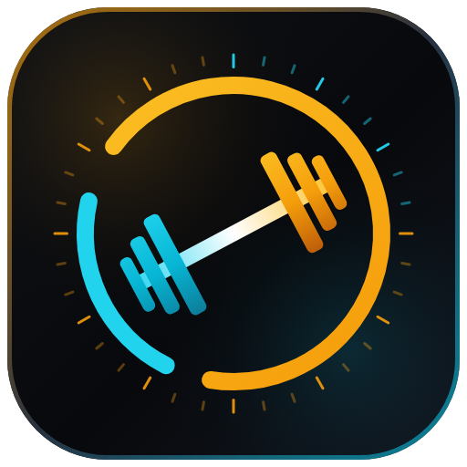
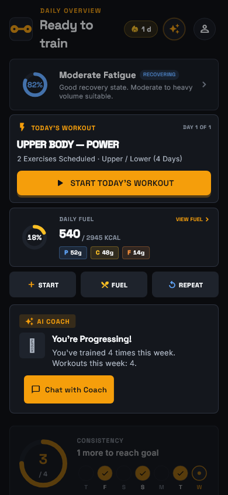
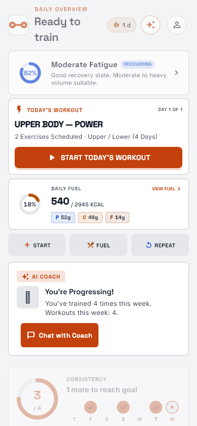
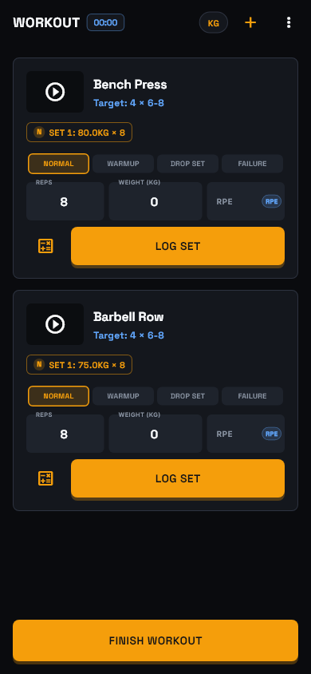
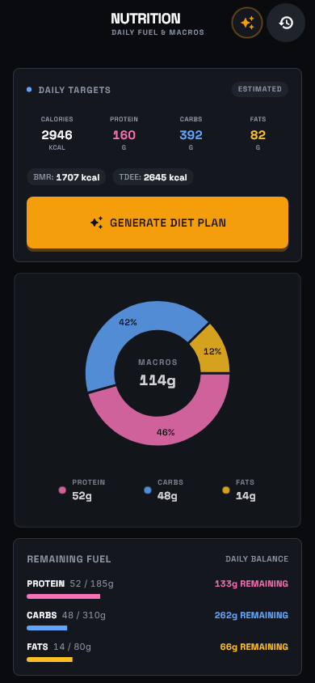
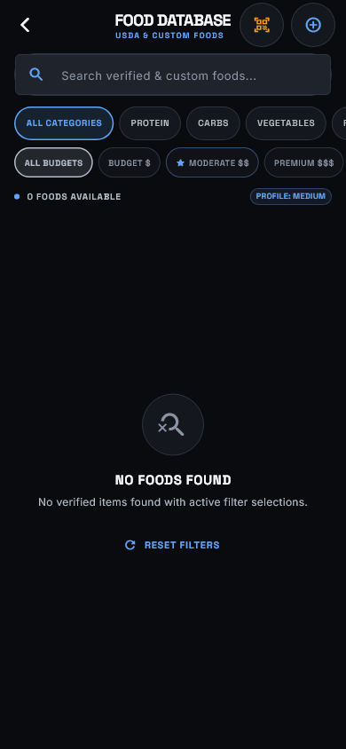
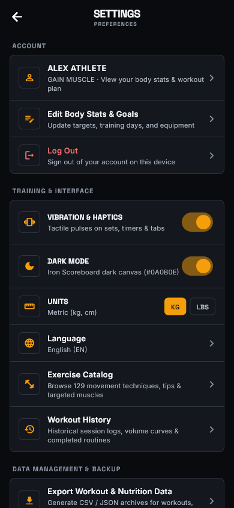
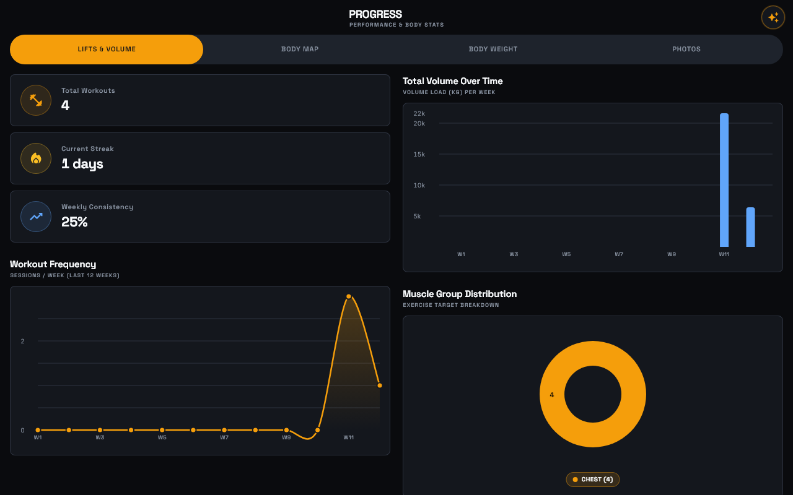
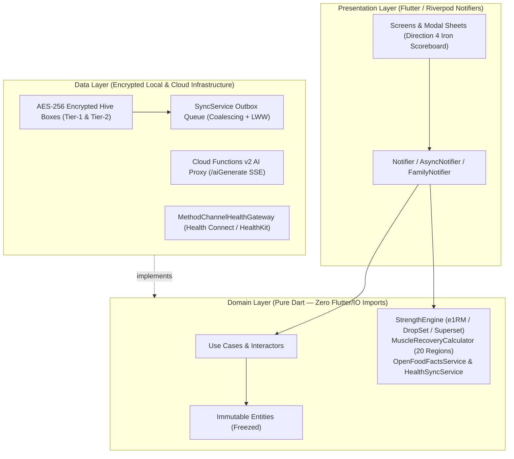

# 🏋️ IronFlow — AI-Powered Fitness, Strength Progression & Anatomical Recovery Platform (`v2.0.0+9`)

<div align="center">



<br />


**Your offline-first, AES-256 encrypted strength training, nutrition telemetry, 2D vector anatomical recovery, and streaming AI coaching companion.**

[Overview](#-overview) • [What We Have Built](#-what-we-have-built-complete-feature-inventory) • [Screenshots](#-screenshots) • [Architecture](#-system-architecture--project-structure) • [Design System](#-iron-scoreboard-design-system--tactile-telemetry) • [Waves 1–9 Ledger](#-master-plan-v2-waves-19--adr-ledger) • [Getting Started](#-getting-started--configuration) • [Testing & Quality](#-testing--verification-gates) • [Deployment](#-production-deployment) • [What We Want Next (Roadmap)](#-what-we-want-next-v30-product-roadmap)

</div>

---

## 📋 Table of Contents

1. [Overview & Core Philosophy](#-overview)
2. [What We Have Built (Complete Feature Inventory)](#-what-we-have-built-complete-feature-inventory)
   - [Workout Management & Active Gym-Floor Logging](#1-️♂️-workout-management--active-gym-floor-logging)
   - [Strength Engine: e1RM, Drop Sets & Superset Linking](#2--strength-engine-e1rm-drop-sets--superset-linking-adr-004)
   - [Interactive Split Generator & Program Builder](#3-️-interactive-split-generator--program-builder)
   - [Built-In Gym Tools & Calculators Hub](#4-🧮-built-in-gym-tools--calculators-hub)
   - [Nutrition Telemetry, USDA Catalog, Barcode Scanner & Meal Vision](#5-🥗-nutrition-telemetry-usda-catalog-barcode-scanner--meal-vision)
   - [20-Region 2D Vector Anatomical Body Map & Recovery Engine](#6-🧬-20-region-2d-vector-anatomical-body-map--recovery-engine-adr-006)
   - [Body Composition, Weight Trends & Progress Photos](#7-📊-body-composition-weight-trends--progress-photos)
   - [Streaming AI Coach, Tap-to-Apply Actions & Voice TTS](#8-🤖-streaming-ai-coach-tap-to-apply-actions--voice-tts-adr-001--adr-003)
   - [Lock-Screen Chronometer Rest Timer & Smart Notifications](#9-🔔-lock-screen-chronometer-rest-timer--smart-notifications-adr-004)
   - [Health Connect (Android) & Apple HealthKit Two-Way Sync](#10-❤️-health-connect-android--apple-healthkit-two-way-sync-adr-008)
   - [Offline-First AES-256 Storage, Cloud Sync & Multi-User Isolation](#11-☁️-offline-first-aes-256-storage-cloud-sync--multi-user-isolation)
   - [Privacy Sovereignty, Telemetry Consent & Legal Compliance](#12-🛡️-privacy-sovereignty-telemetry-consent--legal-compliance)
3. [Screenshots (Mobile & Wide Web Viewports)](#-screenshots)
4. [Technology Stack](#-technology-stack)
5. [System Architecture & Project Structure](#-system-architecture--project-structure)
6. [Iron Scoreboard Design System & Tactile Telemetry](#-iron-scoreboard-design-system--tactile-telemetry)
7. [Master Plan V2 (Waves 1–9) & ADR Ledger](#-master-plan-v2-waves-19--adr-ledger)
8. [Getting Started & Configuration](#-getting-started--configuration)
9. [Testing & Verification Gates](#-testing--verification-gates)
10. [Production Deployment](#-production-deployment)
11. [What We Want Next (V3.0 Product Roadmap)](#-what-we-want-next-v30-product-roadmap)
12. [Documentation Index & License](#-documentation-index)

---

## 🎯 Overview

**IronFlow (`progression_tracker` v2.0.0+9)** is an institutional-grade, offline-first Flutter application engineered for serious lifters, athletes, and coaches across **Android, Web PWA (CanvasKit & WebAssembly), and iOS**.

Unlike cloud-dependent fitness trackers that fail in basement gyms or leak API keys in client binaries, IronFlow is built around six non-negotiable engineering pillars:

1. **100% Offline-First Execution**: Every workout, superset, set entry, meal log, body measurement, and recovery calculation executes locally in **<5ms** with zero network dependency.
2. **AES-256 At-Rest Encryption (`ADR-002`)**: All personal health, workout, nutrition, and AI chat Hive boxes are encrypted on-device using 256-bit AES (`HiveAesCipher`) backed by hardware keystores (`FlutterSecureStorage`), complete with automatic migration and corrupt-box quarantine recovery.
3. **Zero Client Secrets (`ADR-001`)**: Release builds compile with `ALLOW_DIRECT_AI_KEYS=false` (fail-closed). All Gemini 2.5 Flash traffic routes through an authenticated **Firebase Cloud Functions 2nd Gen SSE proxy (`functions/aiGenerate`)** with Firebase Auth JWT verification, staged **Firebase App Check**, and durable per-user daily Firestore quotas with atomic refunds on upstream errors.
4. **Pure-Dart Domain & Clean Architecture (`ADR-007`)**: Enforced by 10 automated architecture hygiene guards (`test/architecture/architecture_hygiene_test.dart`), guaranteeing zero Flutter/Riverpod imports in `domain/`, zero legacy `StateNotifier` classes, zero `.withOpacity(` calls, and a strict **$\le 800$-line ceiling** on every non-generated Dart file in `lib/`.
5. **High-Contrast Gym-Floor Ergonomics ("Iron Scoreboard")**: Engineered for one-handed use under gym lighting with `#0A0B0E` obsidian dark and `#F3F4F6` titanium light surfaces, `#F59E0B` amber primary actions, `#06B6D4` cyan telemetry accents, bundled OFL typography (`Space Grotesk` & `Inter`), and $\ge 48\text{dp}$ touch targets.
6. **Global Localization & Accessibility**: Full 7-locale support (**English, Arabic [RTL], German, Spanish, French, Portuguese, Chinese**) with 100% ARB key/placeholder parity, `2.0x` text-scaler resilience, reduced-motion compliance, and screen-reader semantic alternatives.

---

## ✨ What We Have Built (Complete Feature Inventory)

### 1. 🏋️‍♂️ Workout Management & Active Gym-Floor Logging
- **4-Tab Navigation Shell (`AppRouter`)**: Streamlined navigation across **Today (`/home`)**, **Workout (`/workout`)**, **Fuel (`/nutrition`)**, and **Progress (`/progress`)**, with full state preservation and deep-link redirects.
- **Active Workout Session (`ActiveWorkoutScreen`)**:
  - Real-time elapsed session clock, live unit switcher (`KG` / `LBS`), and quick-access plate calculator trigger on every exercise card.
  - Set classification tags: **`NORMAL`**, **`WARMUP`**, **`DROP SET`**, and **`FAILURE`** sets, plus per-set **RPE (Rate of Perceived Exertion)** logging.
  - Crash-resilient active workout state persistence (`WorkoutStateManager`) scoped by user ID so unfinished workouts survive app restarts or phone reboots.
- **129 Deduplicated Exercises (`ExerciseCatalog`)**:
  - Lazy-loaded JSON catalog (`assets/data/exercises_catalog.json`) indexed in a background isolate (`CatalogSearchIndex`) for sub-millisecond search.
  - Canonical alias migration (`ExerciseDatabase.aliasMap`) automatically upgrades legacy or duplicate exercise IDs across historical workouts.
- **Unified Exercise Media Stage (`ExerciseMediaStage`)**:
  - Displays 2D anatomical target-muscle vector highlights, step-by-step form instructions, and dual-coach YouTube video demonstrations (**Coach 1** & **Coach 2**) with privacy-preserving tap-to-load iframe deferral.
- **Personal Records & Celebration HUD (`PRCelebrationAnimation`)**:
  - Automatic detection of weight, volume, and e1RM personal records with tactile haptic celebration (`AppHaptics.milestoneReached`) and post-workout summary cards (`WorkoutSummaryScreen`).

### 2. ⚡ Strength Engine: e1RM, Drop Sets & Superset Linking (`ADR-004`)
Built in [`lib/features/workout/domain/services/strength_engine.dart`](lib/features/workout/domain/services/strength_engine.dart):
- **`E1rmEngine` (Estimated 1-Rep Max)**:
  - Computes live 1RM estimates using both **Epley** ($W \cdot (1 + \frac{r}{30})$) and **Brzycki** ($W \cdot \frac{36}{37 - r}$) formulas.
  - Clamps rep counts at 10 for physiological accuracy, preserves exact $1.0 \times W$ identity for 1-rep maxes, and strictly excludes warmup sets and drop sets from e1RM records.
  - Includes inverse `weightForReps(e1rm, targetReps)` calculation to recommend working weights for any rep target.
- **`DropSetPlanner`**:
  - Automatically computes stepped **20% weight drops** when `DROP SET` is selected on an active exercise card, rounding down to practical **2.5 kg / 2.5 lb** gym plate increments and grouping contiguous drops into `DropSetChain` analytics.
- **`SupersetEngine`**:
  - Single-tap **`SupersetConnectorDivider`** between adjacent exercise cards links or unlinks exercises into ordered superset blocks (**`SS A1`**, **`SS A2`**, **`SS B1`**, **`SS B2`**).
  - **Auto-Rotation**: Logging a set on `A1` automatically advances active focus to partner exercise `A2`.
  - **Smart Rest Bypass**: Skips the rest timer between intermediate exercises in a superset round (and on drop sets), triggering the full rest countdown only when the round completes.
  - **100% Backward-Compatible Storage**: Nullable `supersetGroupId` persisted across Hive (`ExerciseModel`) and JSON/CSV backup archives (`BackupRecordCodec`).

### 3. 🗓️ Interactive Split Generator & Program Builder
- **336-Combination Split Matrix (`ProgramSelectionScreen`)**:
  - Supports **Full Body**, **Upper / Lower**, **Push / Pull / Legs (PPL)**, **Arnold Split**, **Bro Split**, **Custom**, and **Hybrid Splits (e.g., PPL × Arnold)** across **1 to 7 training days per week** and all equipment profiles (`Full Gym`, `Dumbbell Only`, `Bodyweight / Home`).
- **Live Muscle Frequency Telemetry**:
  - Real-time preview of weekly set volume and frequency per muscle group before applying a program.
- **In-Place Exercise Swapping & Undo Protection**:
  - Swap any prescribed exercise with biomechanically matched alternatives and restore the previous program with one-tap `UNDO`.

### 4. 🧮 Built-In Gym Tools & Calculators Hub
Accessible from the Workout & Today screens (`lib/features/tools/`):
- **Barbell Plate Calculator (`PlateCalculator`)**: Visual per-side plate breakdown for standard 20 kg / 45 lb barbells across metric (`25, 20, 15, 10, 5, 2.5, 1.25 kg`) and imperial (`45, 35, 25, 10, 5, 2.5 lb`) plates, surfacing exact remainder warnings when a target weight cannot be evenly loaded.
- **1RM Percentage & Rep-Max Table (`OneRepMaxSheet`)**: Interactive calculator mapping 1RM across 50%–100% intensity zones.
- **Hydration & Water Intake Calculator (`WaterIntakeCalculator`)**: Computes daily fluid requirements based on bodyweight, workout duration, and ambient climate.
- **BMR / TDEE & Macro Split Calculator**: Mifflin-St Jeor metabolic rate and goal-based calorie/macro target generator.

### 5. 🥗 Nutrition Telemetry, USDA Catalog, Barcode Scanner & Meal Vision
- **282 Verified USDA Foods + Custom Food Library (`FoodCatalog`)**:
  - Lazy JSON catalog (`assets/data/foods_catalog.json`) with background-isolate search indexing.
  - Tracks per-100g calories, protein, carbohydrates, fat, and **14 micronutrients (`FoodMicros`)**: fiber, sugar, sodium, potassium, calcium, iron, magnesium, zinc, saturated fat, and vitamins A, B, C, D, and E (explicitly distinguishing `0g` from unmeasured `No data`).
  - **Meal Snapshot Immutability**: Logged meals freeze their macro/micro snapshot at log time so future catalog edits never corrupt historical nutrition logs.
- **Budget-Aware Food Alternatives (`GetBudgetFoodAlternativesUseCase`)**:
  - Filters foods by budget tier (`$` Low, `$$` Moderate, `$$$` Premium) and suggests lower-cost, macro-equivalent swaps inside the food detail sheet.
- **Barcode Scanner & Open Food Facts Lookup (`OpenFoodFactsService` & `BarcodeScannerSheet`, `ADR-008`)**:
  - Validates 8-to-14 digit **EAN-8, UPC-A, EAN-13, and GTIN-14** barcodes with **GS1 Modulo-10 check-digit verification**.
  - Resolves common gym staples (Optimum Nutrition Gold Standard Whey, FAGE 0% Greek Yogurt, Quaker Oats, Fairlife Core Power, Quest Protein Bars) in **0ms offline**, and queries **Open Food Facts API v2** (`world.openfoodfacts.org`) with `4P + 4C + 9F` energy fallback and ODbL v1.0 attribution.
  - Automatically caches scanned barcode foods into the user's offline `customFoodsProvider` library.
- **Ephemeral Quick Meal Photo Vision (`QuickMealPhotoSheet`, `ADR-003`)**:
  - Captures or selects a meal photo, resizes it client-side, and sends an ephemeral base64 data URI to the AI proxy to estimate calories and macros — **never storing meal photos in Cloud Storage or Firestore**.

### 6. 🧬 20-Region 2D Vector Anatomical Body Map & Recovery Engine (`ADR-006`)
Built in [`lib/features/body/`](lib/features/body/domain/services/muscle_recovery_calculator.dart):
- **20 Canonical Muscle Regions (`MuscleRegion`)**:
  - **Anterior (13 regions)**: `chest`, `front_delts`, `side_delts`, `biceps`, `forearms`, `upper_abs`, `lower_abs`, `obliques`, `quads`, `adductors`, `calves` (+ bilateral geometry).
  - **Posterior (10 regions)**: `upper_traps`, `rear_delts`, `middle_back`, `lats`, `lower_back`, `triceps`, `glutes`, `hamstrings`, `abductors`, `calves`.
- **Exponential Decay Recovery Calculator (`MuscleRecoveryCalculator`)**:
  - Computes readiness (`0%`–`100%`) and classifies each muscle into **`Fresh`**, **`Recovering`**, **`Fatigued`**, or **`Sore`** using set volume, RPE intensity multipliers, warm-up discounts, 48–72h exponential recovery half-lives, and manual user DOMS soreness overrides.
  - Processes 1 full year of workout history (3,000+ sets) in **<5ms**.
- **Sub-Millisecond Vector Canvas (`BodyMapPainter` & `BodyMapPaths`)**:
  - Pure Flutter `CustomPainter` on a normalized `300×520` coordinate space with exact `ui.Path.contains(offset)` hit-testing (`<0.4ms` paint time per frame).
  - Tapping any muscle region opens `MuscleDetailSheet` with recovery percentage, hours since last trained, contributing exercises, and a direct CTA to train or rest that muscle.
  - Includes a full **Screen-Reader Accessible List View** toggle for assistive technologies.

### 7. 📊 Body Composition, Weight Trends & Progress Photos
- **Segmented Progress Hub (`ProgressScreen`)**:
  - **Recovery Tab**: Interactive 2D Anterior/Posterior Vector Body Map.
  - **Lifts & Volume Tab (`LiftsVolumeTab`)**: e1RM progression curves, weekly tonnage charts, and muscle volume distribution.
  - **Body Weight Tab (`BodyWeightTab`)**: 30-day smoothed weight trend graph (`WeightTrendGraph`), circumference telemetry (neck, shoulders, chest, waist, hips, biceps, thighs, calves), and quick weight logging.
  - **Progress Photos Tab (`ProgressPhotosTab`)**: Side-by-side before/after photo comparison slider (`ProgressPhotoComparison`) with date stamps and local sandboxed storage.

### 8. 🤖 Streaming AI Coach, Tap-to-Apply Actions & Voice TTS (`ADR-001` & `ADR-003`)
- **Server-Sent Events (SSE) Streaming (`CloudProxyAiService`)**:
  - Streams real-time token chunks (`text/event-stream`) from `functions/aiGenerate` with line buffering and incremental markdown rendering.
- **Tap-to-Apply Structured Action Cards (`ActionableAiCard`)**:
  - Parses structured `<action>` blocks emitted by the AI coach to render interactive cards that execute in 1 tap with **`UNDO` rollback**:
    1. **Apply Workout Routine**: Saves a complete AI-designed program directly into active workouts.
    2. **Apply Macro & Calorie Targets**: Updates daily nutrition goals in `NutritionTargets`.
    3. **Swap Exercise**: Replaces an exercise in the active program with a joint-friendly alternative.
- **Normalized FAQ Cache (`AiQuestionNormalizer`)**:
  - High-frequency training and nutrition questions resolve locally in `<1ms` without consuming daily cloud quota.
- **Medical & Clinical Safety Guardrails (`LEG-03`)**:
  - Prompts reporting acute chest pain, dizziness, injury diagnosis, or prohibited substances immediately trigger a deterministic clinical refusal banner (`MedicalDisclaimerBanner`) directing the user to emergency medical care.
- **Hands-Free Voice Coaching (`TtsService`)**:
  - Synchronized text-to-speech playback with word boundary tracking, pause/resume support, and Wasm-safe `dart:js_interop` web speech synthesis.

### 9. 🔔 Lock-Screen Chronometer Rest Timer & Smart Notifications (`ADR-004`)
- **Zero-Battery Android Lock-Screen Chronometer (`RestTimerLiveNotification`)**:
  - Displays a live countdown on the Android lock screen and status bar using the native system chronometer (`channelId: 'rest_timer_live'`, `ongoing: true`, `usesChronometer: true`, `chronometerCountDown: true`, `when: targetEndTime`, `timeoutAfter: remainingMs`, `category: stopwatch`, `visibility: public`).
  - Consumes **0% background Dart CPU** and requires **zero exact-alarm permissions** (`SCHEDULE_EXACT_ALARM` / `USE_EXACT_ALARM` are intentionally omitted for friction-free Google Play compliance).
  - Fires a heads-up completion alert (`id = 99`, channel `rest_timer`) when the rest interval finishes in the background.
- **Web Background Tab Notifications (`BrowserNotifier`)**:
  - Implemented via `dart:js_interop` over the Web Notification API; requests permission on user gesture (timer start) and dispatches a browser notification when `document.hidden == true`.
- **Contextual Scheduled Reminders (`ReminderSettingsScreen`)**:
  - Customizable daily training time and meal logging reminders (never requested on cold launch).

### 10. ❤️ Health Connect (Android) & Apple HealthKit Two-Way Sync (`ADR-008`)
- **`HealthSyncService` & `MethodChannelHealthGateway`**:
  - **Workout Export**: Writes completed workout sessions with start/end timestamps, total volume (kg), and MET-estimated active energy burned ($\text{kcal} = 5.0 \times \text{BW}_{\text{kg}} \times \text{hours} + 8.5 \times \frac{\text{Volume}_{\text{kg}}}{1000}$).
  - **Two-Way Body Weight & Body Fat Sync**: Imports smart-scale weight and body fat records while deduplicating within a 5-minute timestamp window (`<0.05 kg` delta) and exports locally logged `BodyEntry` records.
  - Includes a built-in cross-platform simulation bridge (`HealthPlatformType.simulatedBridge`) so two-way sync can be tested on Web, Desktop, and CI without physical device sensors.

### 11. ☁️ Offline-First AES-256 Storage, Cloud Sync & Multi-User Isolation
- **Two-Tier Encrypted Hive Architecture (`HiveManager` & `HiveEncryptionService`)**:
  - **Tier-1 Instant Boxes**: `app_settings` opened pre-frame for zero-flicker theme, locale, and unit initialization.
  - **Tier-2 Encrypted User Boxes**: `workouts`, `meals`, `body_entries`, `user_profile`, `diet_plan`, `ai_chat`, and `auth_session` encrypted with AES-256.
- **Outbox Coalescing & Unpushed-Edit Protection (`SyncService`)**:
  - Coalesces rapid local edits (`create + update -> create`, `update + delete -> delete`), protects unpushed local records from being overwritten by remote pulls, and uses deterministic LWW (`updatedAt`) conflict resolution with tombstones (`deletedAt`).
- **Strict Multi-User & Guest/Demo Isolation (`RecordOwnershipRules`)**:
  - Switching accounts, using **Offline Guest Mode**, or exploring **Demo Showcase Mode** strictly isolates records by `userId` and prevents local guest/demo data from leaking into Firestore.
- **Validated JSON/CSV Export & Rollback-Safe Restore (`BackupDataUseCase` & `RestoreDataUseCase`)**:
  - Exports portable JSON and CSV archives (preserving `supersetGroupId`, macros, micros, and body entries) and snapshots local storage before restore so any failed import automatically rolls back cleanly.

### 12. 🛡️ Privacy Sovereignty, Telemetry Consent & Legal Compliance
- **Opt-In-Only Telemetry (`TelemetryConsentScreen`)**:
  - Firebase Analytics, Crashlytics, and AI Personalization default to **OFF** until the user explicitly opts in.
- **Full Recursive Account & Data Purge (`DeleteAccountUseCase` & `RemoteDataPurger`)**:
  - Requires typing `DELETE` + re-authentication, then permanently wipes local Hive boxes, recursively deletes all Firestore subcollections (`workouts`, `meals`, `macro_targets`, `profile`, `ai_usage`), deletes Cloud Storage media (`users/{uid}/*`), and deletes the Firebase Auth user.
- **In-App Open Data & Font Attributions (`showAttributionsSheet`)**:
  - Dedicated notices sheet in **Settings → Privacy** and **Settings → About** crediting Open Food Facts (ODbL v1.0 / DbCL v1.0), USDA FoodData Central, SIL Open Font License 1.1 (`Space Grotesk` & `Inter`), and all 227 permissive open-source packages.

---

## 📸 Screenshots

### Mobile Viewport (`390×844` — Direction 4 "Iron Scoreboard")

| Today Dashboard (Dark) | Today Dashboard (Light) | Active Workout (Supersets `A1`/`A2` & e1RM) |
| :---: | :---: | :---: |
|  |  |  |

| Fuel / Daily Nutrition | Food Database & Barcode Action | Open Food Facts Barcode Scanner (`ODbL v1.0`) |
| :---: | :---: | :---: |
|  |  |  |

| Progress & 2D Anatomical Body Map | Health Connect & HealthKit Sync | Privacy & Open Data Attributions |
| :---: | :---: | :---: |
|  |  |  |

| Settings & Preferences Hub (`390×844`) |
| :---: |
|  |

### Wide / Desktop Web Viewport (`1280×800`)

| Today Dashboard (`1280×800`) | Active Workout (`1280×800`) |
| :---: | :---: |
|  |  |

| Fuel / Nutrition (`1280×800`) | Progress & Body Map (`1280×800`) |
| :---: | :---: |
|  |  |

---

## 🛠️ Technology Stack

| Layer | Technology | Purpose |
| :--- | :--- | :--- |
| **UI Framework** | Flutter `3.24+` / Dart `3.5+` | Cross-platform rendering for Android, Web PWA (CanvasKit/Wasm), and iOS |
| **State Management** | `flutter_riverpod: ^2.6.1` | Modern `Notifier`, `AsyncNotifier`, and `FamilyNotifier` state orchestration (`ADR-007`) |
| **Navigation** | `go_router: ^14.6.2` | Declarative 4-tab shell routing, auth/onboarding guards, and deep-link redirects |
| **Local Database** | `hive: ^2.2.3` + `HiveAesCipher` | Offline-first NoSQL persistence encrypted at rest with 256-bit AES (`ADR-002`) |
| **Hardware Keystore** | `flutter_secure_storage: ^9.2.2` (+ Wasm override) | Android Keystore, iOS Keychain, and WebCrypto `window.crypto.subtle` AES-GCM master key storage |
| **Cloud Backend** | Firebase Auth, Cloud Firestore, Cloud Storage | Multi-device synchronization, recursive account deletion, and media storage |
| **AI Serverless Proxy** | Firebase Cloud Functions 2nd Gen (`Node.js 20`) | Authenticated `/aiGenerate` SSE proxy for Google Gemini 2.5 Flash (`ADR-001`) |
| **Bot & APK Protection** | `firebase_app_check` | Play Integrity (Android), App Attest (iOS), and reCAPTCHA Enterprise (Web) |
| **Vector Graphics & Charts** | Custom `ui.Path` `CustomPainter`, `fl_chart`, `flutter_svg` | 20-region 2D Vector Body Map (`<0.4ms` paint) and strength/weight telemetry graphs |
| **Media & Speech** | `youtube_player_iframe`, `image_picker`, `flutter_tts` | Dual-coach exercise videos, ephemeral meal vision capture, and Wasm-ready voice coaching |
| **Notifications** | `flutter_local_notifications`, `dart:js_interop` | Android system chronometer lock-screen timer (`ADR-004`) and Web Notification API |
| **Localization** | `flutter_localizations`, `intl` | 7 supported locales (`en`, `ar`, `de`, `es`, `fr`, `pt`, `zh`) with full RTL support |

---

## 🏗️ System Architecture & Project Structure



### Repository Directory Layout
```text
ironflow-fitness-app/
├── android/                        # Android Gradle config, R8 rules, Play Integrity setup
├── assets/
│   ├── data/                       # Lazy JSON catalogs (exercises_catalog.json, foods_catalog.json)
│   ├── fonts/                      # Bundled SpaceGrotesk.ttf, Inter.ttf & OFL.txt license
│   ├── images/ & svg/              # Brand assets and vector icons
├── config/                         # Compile-time flavor configs (development, staging, production.json)
├── docs/
│   ├── adr/                        # Architecture Decision Records (ADR-001 through ADR-009)
│   ├── audit/                      # Normalized 812-row FILE_LEDGER.csv & baseline reports
│   ├── CLIENT_PACK/                # Complete Handover Pack (Architecture, Runbook, Key Rotation, Licenses)
│   ├── legal/                      # Privacy Policy, Terms of Service, Fitness & Medical Disclaimer
│   ├── plans/                      # Wave 1–9 execution plans and verification logs
│   └── screenshots/wave4-after/    # Production 390x844 and 1280x800 PNG screenshots
├── functions/                      # Firebase Cloud Functions v2 AI Proxy (index.js + 10 Node.js tests)
├── lib/
│   ├── core/                       # Theme tokens, router, platform adapters (*_io, *_web, *_stub), encryption
│   ├── dev/                        # Debug-only Design Lab & State Inspector (tree-shaken in release)
│   ├── features/
│   │   ├── ai/                     # Streaming SSE AI coach, ActionableAiCard, FAQ normalizer, TTS
│   │   ├── analytics/              # Volume, consistency, and e1RM analytics
│   │   ├── auth/                   # Firebase Auth, Local Guest Athlete, and Demo Showcase modes
│   │   ├── body/                   # 20-region 2D Vector Body Map, recovery calculator, Health Sync bridge
│   │   ├── design_system/          # Interactive component showcase gallery
│   │   ├── notifications/          # Lock-screen chronometer notification & scheduled reminders
│   │   ├── nutrition/              # USDA catalog, Open Food Facts barcode scanner, macro/micro tracking
│   │   ├── onboarding/             # 7-step athlete onboarding & profile editor
│   │   ├── profile/                # Athlete profile & biometric summary
│   │   ├── retention/              # Streak tracking & consistency milestones
│   │   ├── settings/               # Preferences, JSON/CSV backup/restore, privacy, attributions, deletion
│   │   ├── sync/                   # Offline outbox queue, LWW conflict resolver, sync indicator HUD
│   │   ├── tools/                  # Plate calculator, 1RM table, hydration calculator
│   │   └── workout/                # Active workout logger, StrengthEngine (e1RM/drop/superset), split generator
│   ├── l10n/                       # 7-locale ARB translations (en, ar, de, es, fr, pt, zh)
│   ├── shared/                     # Reusable Iron Scoreboard components, ExerciseMediaStage, AppHaptics
│   └── main.dart                   # Tiered startup initializer & error boundary
├── packages/                       # Wasm-compatible dart:js_interop overrides (flutter_secure_storage_web, flutter_tts)
├── scripts/                        # Coverage ratchet (check_coverage.py), perf budgets, no-cache web server
└── test/                           # 1,126 unit, widget, characterization, a11y, RTL, golden & hygiene tests
```

---

## 🎨 Iron Scoreboard Design System & Tactile Telemetry

IronFlow's **Direction 4 ("Iron Scoreboard")** design system (`lib/core/theme/app_theme_tokens.dart`) is built for high-glare and low-light gym environments:

- **Color Tokens (`AppThemeTokens`)**:
  - **Dark Theme**: Canvas `#0A0B0E`, Panel `#12151B`, Card `#181C24`, Kinetic Accent `#F59E0B` (Amber), Telemetry Accent `#06B6D4` (Cyan), Success `#10B981`, Warning `#F59E0B`, Error `#EF4444`.
  - **Light Theme**: Canvas `#F3F4F6`, Panel `#FFFFFF`, Card `#F9FAFB`, Primary Text `#0F172A`, Kinetic Accent `#D97706`, Telemetry Accent `#0891B2`.
- **Typography (`AppTypography`)**:
  - **Display & Numeric Readouts**: `Space Grotesk` (`tabularFigures` enabled so timers and weights never jitter).
  - **Body & Coaching Copy**: `Inter` for clean readability across long-form explanations.
- **Tactile Telemetry (`AppHaptics`)**:
  - Centralized haptic service firing semantic feedback on set completion (`setLogged`), rest timer expiration (`restTimerComplete`), daily macro milestones (`milestoneReached` — capped at once per milestone per calendar day), and tab switches (`selectionChanged`), with a global toggle in Settings.

---

## 📜 Master Plan V2 (Waves 1–9) & ADR Ledger

| Wave / ADR | Scope & Deliverable | Status |
| :--- | :--- | :---: |
| **Wave 0** | Full 360° codebase audit, 800+ file ledger, baseline scorecard, and 12 hardening tracks | ✅ Done |
| **Wave 1 (`ADR-001`, `ADR-002`, `ADR-009`)** | Cloud Functions v2 `/aiGenerate` proxy, staged App Check, Firestore & Storage owner rules, AES-256 Hive encryption + quarantine recovery, multi-user sync isolation, git history secret purge | ✅ Done |
| **Wave 2 (`ADR-005`)** | Characterization & E2E test suites, coverage ratchet gate (`check_coverage.py`), flavor configs (`dev`/`staging`/`prod`), Firestore emergency kill switches, opt-in telemetry consent | ✅ Done |
| **Wave 3 (`ADR-007`)** | 100% migration from `StateNotifier` to Riverpod `Notifier`/`AsyncNotifier`, all `lib/` files split $\le 800$ lines, lazy JSON catalogs + background-isolate search, 10 architecture hygiene guards | ✅ Done |
| **Wave 4** | Direction 4 ("Iron Scoreboard") UI migration across all screens, coherent KG/LBS unit conversion, 7-locale l10n wiring | ✅ Done |
| **Wave 5 (`ADR-006`)** | 20-region 2D Vector Body Map (`BodyMapPainter`), exponential decay `MuscleRecoveryCalculator` (`<5ms`), unified `ExerciseMediaStage` | ✅ Done |
| **Wave 6** | Performance & bundle size budgets (`check_perf_budgets.py`), Android R8 shrinking, 7-locale 100% ARB parity, RTL & `2.0x` text-scale accessibility suite, `AiQuestionNormalizer` cache | ✅ Done |
| **Wave 7 (`ADR-003`)** | End-to-end SSE streaming AI proxy, Tap-to-Apply `ActionableAiCard` with Undo, ephemeral meal photo vision estimation, synchronized TTS pause/resume | ✅ Done |
| **Wave 8 (`ADR-004`, `ADR-008`)** | **8.1** Android lock-screen chronometer rest timer + Web notifications; **8.2** Open Food Facts barcode scanner; **8.3** `E1rmEngine` + `DropSetPlanner` + `SupersetEngine` (`A1`/`A2`); **8.4** Health Connect & HealthKit two-way sync bridge; **8.5** Remote feature flags; **Option 1** WebAssembly (`--wasm-dry-run`) compatibility | ✅ Done |
| **Wave 9** | In-app ODbL/USDA/OFL attributions sheet, updated Privacy Policy & Store Data Disclosure, Client Technical Handover Pack (`docs/CLIENT_PACK/`), normalized 812-row `FILE_LEDGER.csv`, final acceptance | ✅ Done |

---

## 🚀 Getting Started & Configuration

### Prerequisites
- **Flutter SDK**: `3.24.0+` (Dart `3.5.0+`)
- **Node.js**: `18.x` or `20.x LTS` (for `functions/` tests and deployment)
- **Java JDK**: `17` or `21` (for Android Gradle builds)

### 1. Clone & Install Dependencies
```bash
git clone https://github.com/hamdiouni/ironflow-fitness-app.git
cd ironflow-fitness-app
flutter pub get
```

### 2. Run in Local / Demo Showcase Mode (Zero Cloud Setup Required)
By default, IronFlow runs in local-first mode with AES-256 encrypted Hive boxes. On the welcome screen, you can tap **Try Demo Showcase** (pre-loaded with realistic workouts, supersets, nutrition logs, and body metrics) or **Continue Offline as Guest**:
```bash
# Run on Android / Desktop
flutter run --dart-define-from-file=config/development.json

# Build & serve release Web app on http://localhost:8090 (with no-cache headers)
flutter build web --release --no-pub
python scripts/serve_web_nocache.py 8090 build/web
```

### 3. Environment Flavor Configurations (`config/*.json`)
IronFlow uses compile-time `--dart-define-from-file` JSON configurations instead of runtime `.env` files:
- [`config/development.json`](config/development.json): Local development defaults (`ALLOW_DIRECT_AI_KEYS: true` for local debug testing).
- [`config/staging.json`](config/staging.json): Staging Firebase project (`ironflow-staging`), App Check monitor mode.
- [`config/production.json`](config/production.json): Production Firebase project (`ironflow-5b79d`), `USE_FIREBASE_AUTH: true`, `ENABLE_CLOUD_SYNC: true`, `ALLOW_DIRECT_AI_KEYS: false` (fail-closed).

---

## 🧪 Testing & Verification Gates

IronFlow is verified by **1,126 automated tests** across unit, widget, characterization, property-based, accessibility, RTL, and architecture hygiene suites, plus **10 Node.js Cloud Functions tests**:

```bash
# 1. Static Analysis (0 errors, 0 warnings)
flutter analyze --no-pub --no-fatal-infos lib test

# 2. Architecture Hygiene Guards (10/10 rules: pure-Dart domain, <=800 lines, zero StateNotifier)
flutter test --no-pub test/architecture/architecture_hygiene_test.dart

# 3. Full Flutter Test Suite with Coverage (1,126 tests passing)
flutter test --no-pub --coverage --timeout=60s

# 4. Coverage Ratchet Gate (71.73% overall; enforces per-layer and per-feature floors)
python scripts/check_coverage.py --baseline docs/quality/coverage_baseline.json --fail-on-drop

# 5. Cloud Functions AI Proxy Suite (10/10 tests passing)
npm --prefix functions test

# 6. Secret Scan (0 leaks)
gitleaks git --log-opts="backup/pre-prod-v2-wave-9..HEAD"
```

---

## ☁️ Production Deployment

Step-by-step operational instructions are documented in [`docs/CLIENT_PACK/DEPLOYMENT_RUNBOOK.md`](docs/CLIENT_PACK/DEPLOYMENT_RUNBOOK.md):

```bash
# 1. Provision Gemini API Key in Firebase Secret Manager & Deploy AI Proxy
firebase functions:secrets:set GEMINI_API_KEY
cd functions && npm install && cd ..
firebase deploy --only functions:aiGenerate

# 2. Deploy Audited Firestore & Storage Security Rules + Composite Indexes
firebase deploy --only firestore:rules,firestore:indexes,storage:rules

# 3. Build & Deploy Web PWA (Wasm-Ready) to Firebase Hosting
flutter build web --release --dart-define-from-file=config/production.json
firebase deploy --only hosting

# 4. Build Signed Android App Bundle (.aab) or Split-ABI APKs
flutter build appbundle --release --dart-define-from-file=config/production.json
flutter build apk --release --split-per-abi --dart-define-from-file=config/production.json
```

---

## 🗺️ What We Want Next (V3.0 Product Roadmap)

With Master Plan V2 (Waves 1–9) 100% complete, the following high-impact capabilities define the **IronFlow V3.0 Roadmap**:

### 1. ⌚ Native iOS Live Activities, Dynamic Island & Watch Companion Apps
- [ ] **iOS WidgetKit Live Activity & Dynamic Island Extension**: Build the native Swift `ActivityKit` extension target on macOS/Xcode so iOS 16.2+ users get the same lock-screen and Dynamic Island rest timer countdown already active on Android (`ADR-004`).
- [ ] **Apple Watch (`watchOS`) & WearOS Companion Apps**: Wrist-based set logging, RPE adjustment, rest timer haptic taps, and live heart-rate zone streaming during active workouts.

### 2. 🔌 Native OS Health SDK Bindings & Continuous Camera Barcode Stream
- [ ] **Native Android Health Connect Jetpack SDK & iOS HealthKit Swift Bindings**: Attach native Kotlin/Swift handlers to `com.ironflow.app/health_sync` (`MethodChannelHealthGateway`) so physical Android and iOS devices sync directly with OS health stores alongside smart scales and wearables (`ADR-008`).
- [ ] **Live Camera Viewfinder Barcode Auto-Detection**: Extend `BarcodeScannerSheet` with continuous camera frame decoding (`BarcodeDetector` Web API / native camera stream) so pointing the camera at an EAN-13/UPC package triggers lookup without typing or tapping.

### 3. 🎙️ Voice-First Hands-Free Gym Logging & Biomechanical Form Vision
- [ ] **Push-to-Talk Voice Set Logging**: Hands-free voice commands during active workouts (e.g., *"Log Bench Press 100 kilos for 8 reps at RPE 8.5"*), parsed deterministically into `SetEntry` records.
- [ ] **On-Device Pose Estimation & Bar-Path Tracking (Velocity-Based Training)**: Optional camera-based barbell velocity (`m/s`) and rep tempo tracking to estimate proximity to failure (RIR) automatically.

### 4. 📈 Advanced Periodization, Mesocycle Auto-Regulation & Deload Detection
- [ ] **Multi-Week Mesocycle Progression Blocks**: Automated 4-to-8 week accumulation, intensification, and deload waves that adjust target sets and RIR weekly based on logged RPE and `MuscleRecoveryCalculator` fatigue trends.
- [ ] **Plateau & Systemic Fatigue Detector**: Automatic deload recommendations when e1RM stalls across two consecutive microcycles while soreness or RPE climbs.

### 5. 🤝 Social Accountability, Shareable PR Cards & Coach / Trainer Portal
- [ ] **Shareable Scoreboard PR Cards**: One-tap export of high-contrast Iron Scoreboard workout summaries, 2D Vector Body Map heatmaps, and e1RM milestone cards for social sharing.
- [ ] **Coach & Trainer Portal**: Multi-athlete roster dashboard allowing strength coaches to assign custom programs, review weekly check-in photos/weight trends, and adjust macro targets remotely.
- [ ] **Community Challenges & Training Partner Sync**: Private leaderboards and shared superset/workout lobbies for training partners.

---

## 📚 Documentation Index

| Document | Description |
| :--- | :--- |
| **[`docs/CLIENT_PACK/README.md`](docs/CLIENT_PACK/README.md)** | Executive summary & handover index for Release `2.0.0+9` |
| **[`docs/CLIENT_PACK/ARCHITECTURE_OVERVIEW.md`](docs/CLIENT_PACK/ARCHITECTURE_OVERVIEW.md)** | Deep architectural blueprint (Clean Architecture, Sync, Body Map, AI Proxy, Strength Engine) |
| **[`docs/CLIENT_PACK/DEPLOYMENT_RUNBOOK.md`](docs/CLIENT_PACK/DEPLOYMENT_RUNBOOK.md)** | Step-by-step Firebase, Cloud Functions, App Check, Web & Android release deployment guide |
| **[`docs/CLIENT_PACK/KEY_ROTATION_AND_CREDENTIALS.md`](docs/CLIENT_PACK/KEY_ROTATION_AND_CREDENTIALS.md)** | Zero-trust secrets SOP, Gemini key rotation, and Android keystore management |
| **[`docs/CLIENT_PACK/STORE_RELEASE_CHECKLIST.md`](docs/CLIENT_PACK/STORE_RELEASE_CHECKLIST.md)** | Google Play Store, Web PWA, and Apple App Store pre-submission checklist |
| **[`docs/CLIENT_PACK/DEPENDENCY_LICENSES.csv`](docs/CLIENT_PACK/DEPENDENCY_LICENSES.csv)** | Machine-readable license audit of all 227 locked dependencies (100% permissive) |
| **[`docs/STORE_DATA_DISCLOSURE.md`](docs/STORE_DATA_DISCLOSURE.md)** | Exact Google Play Data Safety & Apple App Privacy questionnaire answers |
| **[`docs/legal/PRIVACY_POLICY.md`](docs/legal/PRIVACY_POLICY.md)** | Production Privacy Policy covering AES-256 local encryption, AI consent, and ODbL open data |
| **[`docs/legal/TERMS_OF_SERVICE.md`](docs/legal/TERMS_OF_SERVICE.md)** | Production Terms of Service & Acceptable Use Policy |
| **[`docs/legal/FITNESS_AND_MEDICAL_DISCLAIMER.md`](docs/legal/FITNESS_AND_MEDICAL_DISCLAIMER.md)** | Non-medical disclaimer & physical training assumption of risk |
| **[`docs/audit/FILE_LEDGER.csv`](docs/audit/FILE_LEDGER.csv)** | Complete 812-row line-by-line file audit ledger |

---

## 📄 License & Open Data Attributions

- **Application Code & Proprietary Vector Assets**: Licensed under the [MIT License](LICENSE).
- **Open Food Facts**: Nutritional barcode data is sourced from [Open Food Facts](https://world.openfoodfacts.org/) under the **Open Database License (ODbL) v1.0** and **Database Contents License (DbCL) v1.0**.
- **USDA FoodData Central**: Core food composition values are derived from the U.S. Department of Agriculture, Agricultural Research Service (**Public Domain**).
- **Typography**: `Space Grotesk` and `Inter` are bundled under the **SIL Open Font License 1.1** ([`assets/fonts/OFL.txt`](assets/fonts/OFL.txt)).
