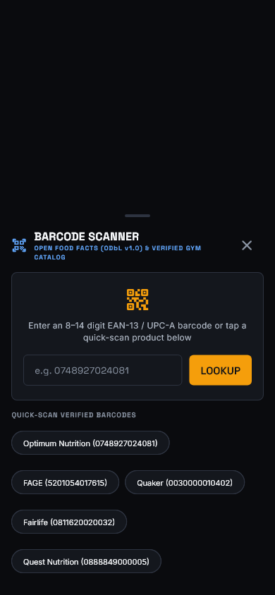
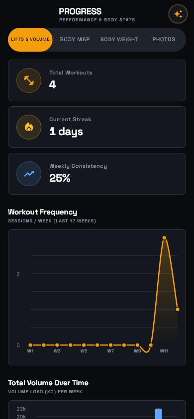
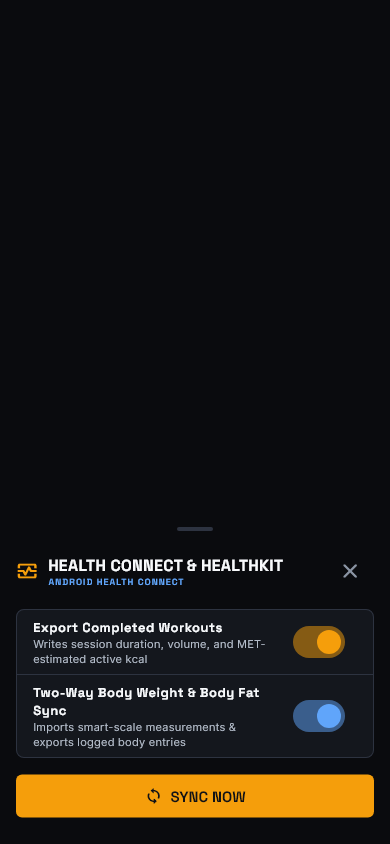
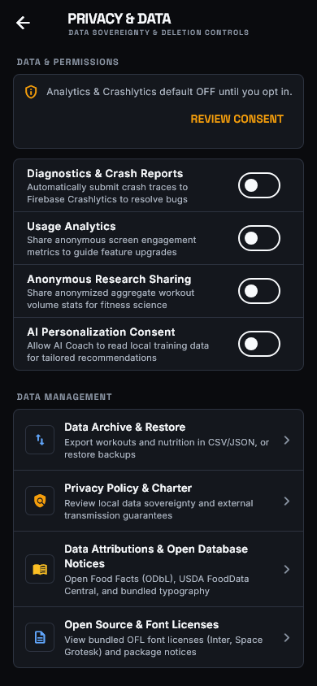
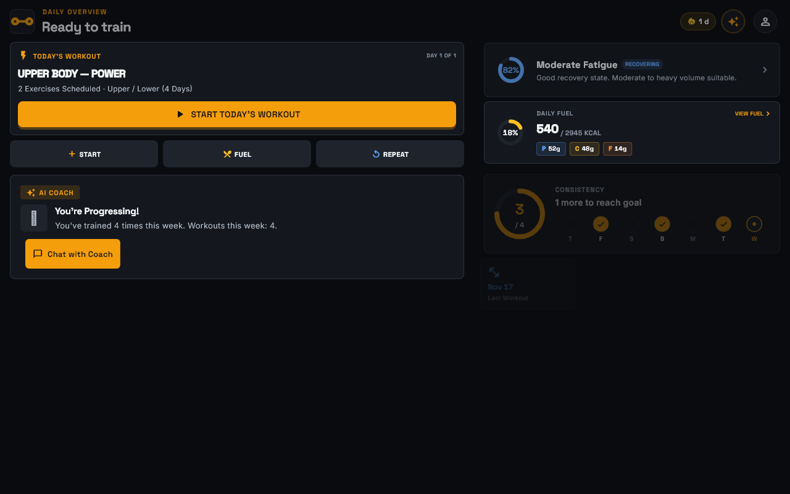
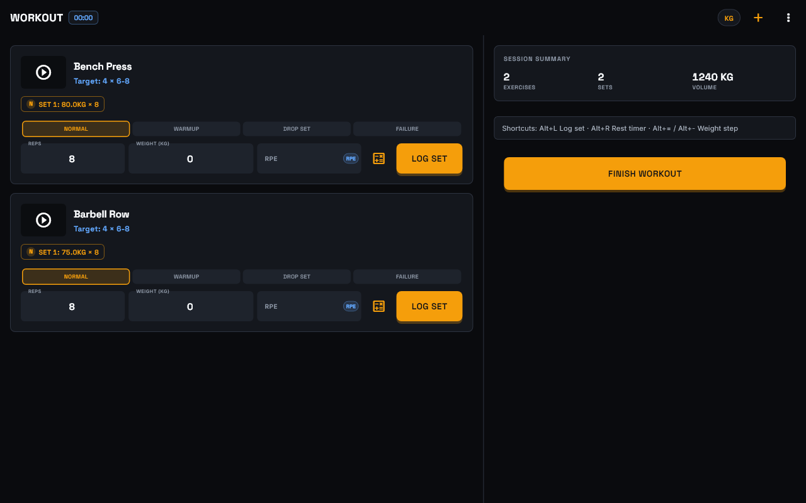
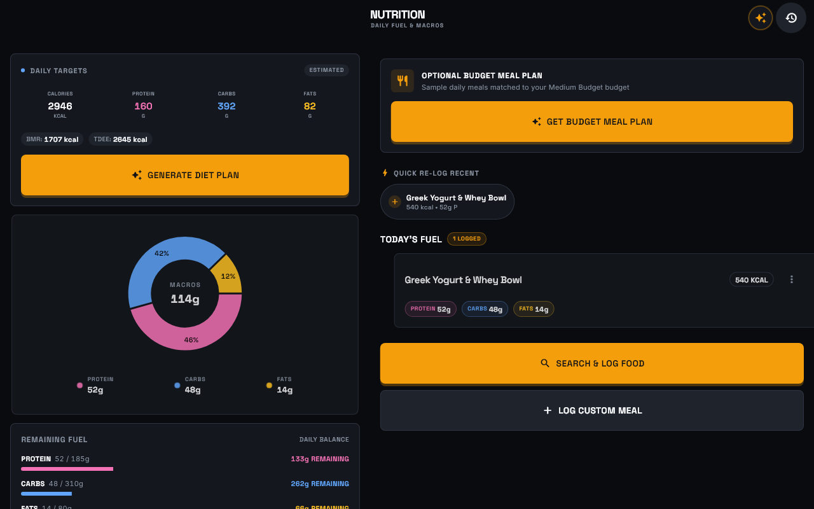

# 🏋️ IronFlow — Production-Hardened Fitness & Strength Progression Platform (`v2.0.0+9`)

<div align="center">


**An offline-first, AES-256 encrypted strength, nutrition, anatomical recovery, and AI coaching platform engineered with Clean Architecture and the Direction 4 ("Iron Scoreboard") design system.**

[Overview](#-overview) • [Screenshots](#-screenshots) • [Key Features](#-key-features) • [Architecture](#-architecture) • [Quality Scorecard](#-production-quality-scorecard) • [Getting Started](#-getting-started) • [Deployment](#-deployment) • [Documentation](#-documentation-index)

</div>

---

## 🎯 Overview

**IronFlow (`progression_tracker` v2.0.0+9)** is a cross-platform mobile and web fitness tracking platform built for lifters and athletes. Completed across **Master Plan V2 (Waves 1–9)**, it combines zero-latency offline workout logging, an interactive 20-region 2D vector anatomical recovery map, an e1RM / drop-set / superset strength engine, USDA + Open Food Facts nutrition & barcode lookup, Health Connect & Apple HealthKit synchronization, and an authenticated serverless Gemini 2.5 Flash SSE streaming coach.

### Core Production Guarantees
- **🔒 Zero Client Secrets (`ADR-001`)**: Release builds compile with `ALLOW_DIRECT_AI_KEYS=false` (fail-closed). All AI traffic routes through an authenticated Firebase Cloud Functions 2nd Gen proxy (`functions/aiGenerate`) protected by Firebase Auth JWT verification, Firebase App Check, and durable per-user daily quotas with atomic error refunds.
- **🛡️ AES-256 Encrypted Local Storage (`ADR-002`)**: All sensitive Hive boxes (`workouts`, `meals`, `body_entries`, `user_profile`, `ai_chat`, `auth_session`) are encrypted at rest with hardware-backed keys (`FlutterSecureStorage`) and automatic box-by-box migration + corrupt-box quarantine recovery.
- **⚡ Strength Engine, Drop Sets & Supersets (`ADR-004`)**: Unified `E1rmEngine` (Epley & Brzycki formulas capped at 10 reps, filtering warmups and drop sets), `DropSetPlanner` (20% stepped plate reductions), and 1-tap `SupersetEngine` (`A1`/`A2` block linking, active exercise auto-rotation, and smart rest-timer bypass).
- **⏱️ Zero-Battery Lock-Screen Rest Timer (`ADR-004`)**: Uses Android's native system notification chronometer (`usesChronometer: true`, `chronometerCountDown: true`, `category: stopwatch`) requiring **0% background Dart CPU** and **no** high-risk `SCHEDULE_EXACT_ALARM` permission, paired with Web Notification API background alerts via `dart:js_interop`.
- **🧬 20-Region 2D Vector Body Map (`ADR-006`)**: Dependency-free `CustomPainter` rendering front and posterior anatomical silhouettes with `<0.4ms` frame paint latency and `<5ms` exponential muscle recovery calculation over a full year of workouts (3,000+ sets).
- **🌐 WebAssembly (`--wasm-dry-run`) Verified (`ADR-008`)**: 100% `dart:js_interop` web plugin architecture passing Flutter's WebAssembly dry-run check with zero warnings.

---

## 📸 Screenshots

### Mobile Viewport (`390×844` — Direction 4 "Iron Scoreboard")

| Today Dashboard (Dark) | Today Dashboard (Light) | Active Workout (Supersets `A1`/`A2` & e1RM) |
| :---: | :---: | :---: |
|  |  |  |

| Fuel / Daily Nutrition | Food Database & Barcode Action | Open Food Facts Barcode Scanner (`ODbL v1.0`) |
| :---: | :---: | :---: |
|  |  |  |

| Progress & 2D Anatomical Body Map | Health Connect & HealthKit Sync | Privacy & Open Data Attributions |
| :---: | :---: | :---: |
|  |  |  |

### Wide / Desktop Web Viewport (`1280×800`)

| Today Dashboard (`1280×800`) | Active Workout (`1280×800`) |
| :---: | :---: |
|  |  |

| Fuel / Nutrition (`1280×800`) | Progress & Body Map (`1280×800`) |
| :---: | :---: |
|  |  |

---

## ✨ Key Features

### 🏋️‍♂️ Workout & Strength Progression (`Wave 4` & `Wave 8`)
- **Superset Linking (`SupersetEngine`)**: Link or unlink adjacent exercises into `A1`/`A2`, `B1`/`B2` superset blocks with a single tap on `SupersetConnectorDivider`. Completing a set automatically rotates focus to the next exercise in the round and holds the rest timer until the round finishes.
- **Estimated 1RM Engine (`E1rmEngine`)**: Live Epley and Brzycki 1RM telemetry on every exercise card, capped at 10 reps for physiological accuracy and strictly excluding warmup and drop sets.
- **Drop-Set Planner (`DropSetPlanner`)**: Selecting `DROP SET` automatically pre-fills a 20% stepped weight reduction rounded down to standard 2.5 kg/lb gym plates.
- **129 Deduplicated Exercises + Unified Media Stage**: Lazy JSON catalog indexed in a background isolate with canonical alias migration, 2D anatomical muscle highlighting, step-by-step coaching cues, and tap-to-load YouTube embeds.
- **Interactive Split Generator**: Supports Full Body, Upper/Lower, Push/Pull/Legs, Arnold Split, and hybrid schedules across 1–7 days/week with live muscle frequency telemetry and one-tap Undo.

### 🥗 Nutrition, Barcode Lookup & Ephemeral Meal Vision (`Wave 7` & `Wave 8.2`)
- **282 Verified USDA Foods + Custom Library**: Background-isolate indexed catalog with per-100g macros, true micronutrient telemetry (`FoodMicros`), serving descriptors, and budget-tier filtering (`$`, `$$`, `$$$`).
- **Barcode Scanner & Open Food Facts (`OpenFoodFactsService`, `ADR-008`)**: Validates EAN-13, EAN-8, UPC-A, and GTIN-14 barcodes (including GS1 Modulo-10 check digits), resolves against an instant offline gym-food catalog first, queries Open Food Facts API v2 under ODbL v1.0 attribution, and auto-caches scanned items into the user's offline food library.
- **Ephemeral Quick Meal Photo Estimation (`ADR-003`)**: Resizes meal photos on-device and streams a base64 data URI to the AI proxy for macro estimation with **zero cloud storage retention**.

### 🧬 2D Vector Body Map & Health Sync (`Wave 5` & `Wave 8.4`)
- **20-Region Anatomical Recovery Model**: Tracks recovery across 20 distinct front and posterior muscle groups (`Fresh`, `Recovering`, `Fatigued`, `Sore`) with user DOMS soreness overrides and a full screen-reader accessible list view.
- **Health Connect & Apple HealthKit Bridge (`HealthSyncService`, `ADR-008`)**: Opt-in two-way body weight / body fat synchronization with 5-minute timestamp deduplication and completed workout export (duration, volume, and MET-estimated active kilocalories).

### 🤖 Streaming AI Coach & Tap-to-Apply Actions (`Wave 7`)
- **End-to-End Server-Sent Events (SSE) Streaming**: Incremental token streaming from `functions/aiGenerate` with `BLOCK_MEDIUM_AND_ABOVE` safety thresholds and medical emergency refusal guardrails (`LEG-03`).
- **Tap-to-Apply Structured Action Cards (`ActionableAiCard`)**: One-tap application with instant `UNDO` rollback for AI-proposed workout routines, macro target updates, and exercise substitutions.
- **Synchronized Voice Coaching**: Text-to-speech playback with pause/resume state tracking and normalized local FAQ caching (`AiQuestionNormalizer`).

---

## 🏗️ Architecture

IronFlow enforces strict **Clean Architecture** boundaries verified on every test run by [`test/architecture/architecture_hygiene_test.dart`](test/architecture/architecture_hygiene_test.dart):

1. **Domain Layer (`lib/features/*/domain/`)**: Pure Dart — zero Flutter, Riverpod, or I/O imports.
2. **Data Layer (`lib/features/*/data/`)**: AES-256 encrypted Hive repositories, offline outbox sync engine (`SyncService`), Firebase adapters, and `MethodChannelHealthGateway`.
3. **Presentation Layer (`lib/features/*/presentation/`)**: Riverpod 2.6+ `Notifier` / `AsyncNotifier` / `FamilyNotifier` controllers (zero legacy `StateNotifier`) and Direction 4 token-styled widgets.
4. **800-Line File Ceiling**: Every non-generated Dart file in `lib/` is strictly $\le 800$ lines.

---

## 📊 Production Quality Scorecard

```text
========================================================================================
                     IronFlow Release 2.0.0+9 Verification Matrix
========================================================================================
 Static Analysis:           0 errors, 0 warnings (flutter analyze --no-fatal-infos)
 Automated Test Suite:      1,126 / 1,126 tests passing (0 failed, 0 skipped)
 Line Coverage:             71.73% overall (all layer & feature ratchet gates met)
 Architecture Hygiene:      10 / 10 rules passing (all lib/ files <= 800 lines)
 Cloud Functions Proxy:     10 / 10 Node.js tests passing (JWT, App Check, Quotas, SSE)
 Web Bundle & Wasm:         1.63 MB gzipped main.dart.js (< 2.5 MB budget) · Wasm ready
 Localization & a11y:       7 locales (EN, AR, DE, ES, FR, PT, ZH) · 100% ARB parity + RTL
 Secret Scan (gitleaks):    0 leaks in codebase and commit history
 Open Source Licenses:      227 / 227 packages permissive (MIT, BSD, Apache-2.0, ISC)
========================================================================================
```

---

## 🚀 Getting Started

### Prerequisites
- **Flutter SDK**: `3.24+` (Dart `3.5+`)
- **Node.js**: `20.x LTS` (for `functions/` AI proxy tests and deployment)

### 1. Clone & Install
```bash
git clone https://github.com/hamdiouni/ironflow-fitness-app.git
cd ironflow-fitness-app
flutter pub get
```

### 2. Run Locally (Offline-First / Demo Showcase)
IronFlow works out-of-the-box in local-first mode with AES-256 encrypted Hive storage and a pre-populated **Demo Showcase** mode:
```bash
# Run on Android / Desktop
flutter run

# Build & serve release Web app on http://localhost:8090
flutter build web --release
python scripts/serve_web_nocache.py 8090 build/web
```

### 3. Run the Verification Suite
```bash
# 1. Static analysis
flutter analyze --no-pub --no-fatal-infos lib test

# 2. Architecture hygiene guards (10 rules)
flutter test --no-pub test/architecture/architecture_hygiene_test.dart

# 3. Full unit, widget, characterization & E2E test suite with coverage
flutter test --no-pub --coverage --timeout=60s
python scripts/check_coverage.py --baseline docs/quality/coverage_baseline.json --fail-on-drop

# 4. Cloud Functions AI proxy tests
npm --prefix functions test
```

---

## ☁️ Deployment

Full production runbooks are located in [`docs/CLIENT_PACK/`](docs/CLIENT_PACK/README.md):

```bash
# Deploy Firebase Cloud Functions SSE AI Proxy
firebase functions:secrets:set GEMINI_API_KEY
firebase deploy --only functions:aiGenerate

# Deploy Firestore & Storage Security Rules + Indexes
firebase deploy --only firestore:rules,firestore:indexes,storage:rules

# Build Production Web Bundle & Deploy to Firebase Hosting
flutter build web --release --dart-define-from-file=config/production.json
firebase deploy --only hosting

# Build Production Android App Bundle (.aab)
flutter build appbundle --release --dart-define-from-file=config/production.json
```

---

## 📚 Documentation Index

| Document | Path |
| :--- | :--- |
| **Client Technical Handover Pack** | [`docs/CLIENT_PACK/README.md`](docs/CLIENT_PACK/README.md) |
| **System Architecture Overview** | [`docs/CLIENT_PACK/ARCHITECTURE_OVERVIEW.md`](docs/CLIENT_PACK/ARCHITECTURE_OVERVIEW.md) |
| **Production Deployment Runbook** | [`docs/CLIENT_PACK/DEPLOYMENT_RUNBOOK.md`](docs/CLIENT_PACK/DEPLOYMENT_RUNBOOK.md) |
| **Key Rotation & Credentials SOP** | [`docs/CLIENT_PACK/KEY_ROTATION_AND_CREDENTIALS.md`](docs/CLIENT_PACK/KEY_ROTATION_AND_CREDENTIALS.md) |
| **Store Release Checklist** | [`docs/CLIENT_PACK/STORE_RELEASE_CHECKLIST.md`](docs/CLIENT_PACK/STORE_RELEASE_CHECKLIST.md) |
| **Google Play & App Store Data Disclosure** | [`docs/STORE_DATA_DISCLOSURE.md`](docs/STORE_DATA_DISCLOSURE.md) |
| **Legal Policies (Privacy, Terms, Medical Disclaimer)** | [`docs/legal/`](docs/legal/PRIVACY_POLICY.md) |
| **Architecture Decision Records (`ADR-001` – `ADR-009`)** | [`docs/adr/`](docs/adr/008-wasm-barcode-and-health-sync.md) |
| **Normalized Codebase File Ledger (812 files)** | [`docs/audit/FILE_LEDGER.csv`](docs/audit/FILE_LEDGER.csv) |
| **Third-Party Dependency License Audit (227 packages)** | [`docs/CLIENT_PACK/DEPENDENCY_LICENSES.csv`](docs/CLIENT_PACK/DEPENDENCY_LICENSES.csv) |

---

## 📄 License & Attributions

- **Source Code & Proprietary Vector Assets**: Delivered under the project [LICENSE](LICENSE) and commercial handover terms.
- **Open Databases**: Nutritional barcode lookups reference [Open Food Facts](https://world.openfoodfacts.org/) under the **Open Database License (ODbL) v1.0** and **USDA FoodData Central** (public domain).
- **Bundled Typography**: `Space Grotesk` and `Inter` are bundled under the **SIL Open Font License 1.1** (`assets/fonts/OFL.txt`).
