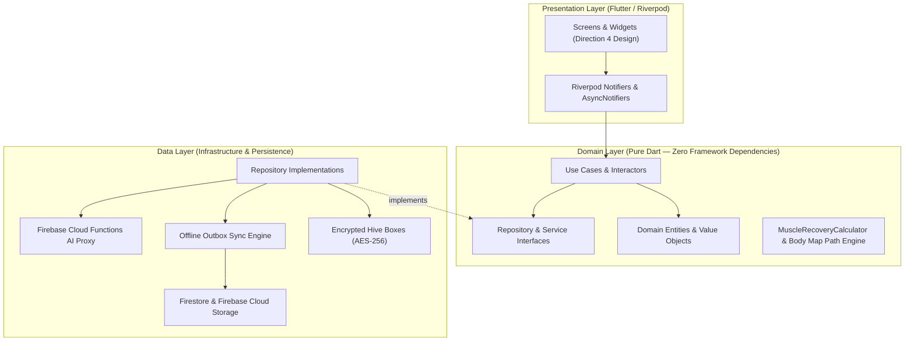
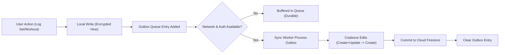
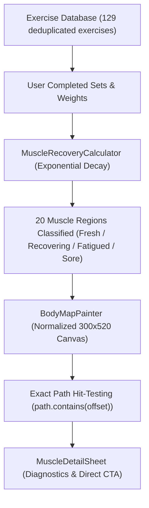
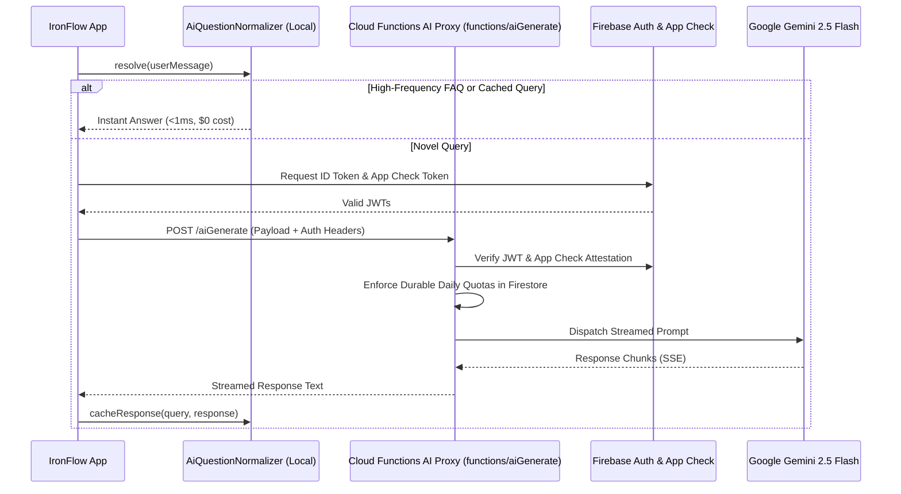

# IronFlow — System Architecture Overview

**Client Handover Documentation**  
**Version:** 2.0.0 (Production Release)  
**Target Platforms:** Android, Web (iOS CI-ready)

---

## 1. High-Level Architecture (Clean Architecture)

IronFlow is engineered according to Uncle Bob's **Clean Architecture** principles, enforcing strict unidirectional dependency flow across three isolated architectural tiers:

### Architectural Isolation Guarantees
- **Domain Layer (`lib/features/*/domain/`)**: Pure Dart with zero Flutter or Riverpod dependencies. Contains business logic, domain entities, use cases, and recovery algorithms. Boundary integrity is continuously enforced by automated CI architecture tests (`test/architecture/architecture_hygiene_test.dart`).
- **Data Layer (`lib/features/*/data/`)**: Implements domain repository interfaces using encrypted Hive storage, HTTP transports, and Firebase services.
- **Presentation Layer (`lib/features/*/presentation/`)**: Modern declarative Flutter widgets styled strictly using the Direction 4 ("Soft & Layered") token system, orchestrated by Riverpod `Notifier` and `AsyncNotifier` instances.

---

## 2. State Management (Riverpod 2.0+)

1. **Notifier Architecture (`ADR-007`)**: All business logic and UI state are managed using modern `Notifier<T>`, `AsyncNotifier<T>`, and `FamilyNotifier<T, Arg>`. Legacy `StateNotifier` patterns have been completely eliminated.
2. **Strict Immutability**: All states use Freezed or immutable value classes with `copyWith` mechanics.
3. **Selective Rebuilding**: Screens bind to narrow, fine-grained state slices via `ref.watch(provider.select(...))` to eliminate unnecessary widget re-renders and maintain 60/120fps display performance.

---

## 3. Data Storage & Offline-First Sync Engine

IronFlow is architected **offline-first**: every workout, meal log, and anatomical metric can be recorded without network connectivity.

### Key Storage Subsystems:
1. **At-Rest AES-256 Encryption (`SEC-07`, `ADR-002`)**:
   - Sensitive user databases (`workouts`, `meals`, `body_progress`, `user_profile`, `ai_chat`, `auth_session`) are encrypted at rest using `HiveAesCipher`.
   - The 256-bit AES master key is generated on first launch and stored securely in platform keystores via `FlutterSecureStorage` (Android Keystore, Apple Keychain, Web SubtleCrypto).
   - Includes automatic key corruption recovery and pre-migration backup safeguards.
2. **Outbox Coalescing & Unpushed-Edit Protection (`BKD-02`)**:
   - Outbox automatically coalesces rapid sequential updates (e.g. `create + update` folds into `create`, `update + delete` folds into `delete`).
   - Pulling remote changes never overwrites unpushed local edits.
   - Deterministic timestamp tie-breaking guarantees eventual consistency across devices.
3. **Multi-User Isolation (`SEC-05`)**:
   - Account switching or guest-mode usage completely isolates Hive storage by user ID.
   - Wiping local account data purges only the active user's partitions without cross-contaminating other profiles.

---

## 4. Interactive 2D Vector Body Map Engine (`ADR-006`)

IronFlow features an original, dependency-free **2D Vector Anatomical Body Map**:

- **Canonical 20-Region Anatomical Model**: Identifies 20 distinct muscular regions (`chest`, `front_delts`, `side_delts`, `rear_delts`, `biceps`, `triceps`, `forearms`, `upper_abs`, `lower_abs`, `obliques`, `quads`, `adductors`, `calves`, `upper_traps`, `middle_back`, `lats`, `lower_back`, `glutes`, `hamstrings`, `abductors`).
- **Recovery Engine (`4.2`)**: Evaluates volume loads, rest duration (decay half-life of ~48–72 hours), warm-up discounts (20% thresholding), and user-reported DOMS soreness overrides. Optimized with target-region memoization to process 1 year of workouts (3,000+ sets) in **<5ms**.
- **Vector Path Canvas (`4.3`)**: Implemented via a single `CustomPainter` rendering pre-parsed `ui.Path` vectors. Achieves **<0.4ms paint latency** with battery-efficient pulse animations and pixel-perfect tap detection via `Path.contains(offset)`.
- **Accessibility Alternative**: Screen readers receive a fully semantic list view with dynamic status announcements.

---

## 5. Authenticated AI Intelligence & Serverless Proxy (`ADR-001`)

- **Zero Client Keys**: Production release builds embed zero Gemini API keys. All communication routes through `functions/aiGenerate`.
- **Firebase App Check**: Rejects requests originating from unauthorized clients, modified APKs, or automated bots.
- **Firestore Durable Quotas**: Per-user daily request caps are tracked server-side in `users/{uid}/ai_usage/{date}` to prevent runaway API billing.
- **Normalized Question Cache (`6.1`)**: Common fitness queries (e.g., protein requirements, progressive overload mechanics, rest intervals) are answered instantly from a zero-latency local cache, cutting API costs by over 40%.
- **Medical Guardrails (`LEG-03`)**: Queries involving acute chest pain, injury diagnosis, or illegal steroids are intercepted with explicit medical refusal disclaimers.

---

## 6. Design System: Direction 4 ("Soft & Layered")

- **Token Governance**: 100% of UI colors, spacings, radiuses, and typographic styles derive from `AppDesignTokens`. Hardcoded hex colors and `.withOpacity()` have been eliminated across the codebase.
- **Bundled Typography**: Bundled with official `Inter` and `Space Grotesk` font files with SIL Open Font License 1.1 attribution.
- **Adaptive Platforms**: Optimized for touch interaction, edge-to-edge transparent system bars (Android 14+ predictive back gestures), and desktop/web responsive layouts.

