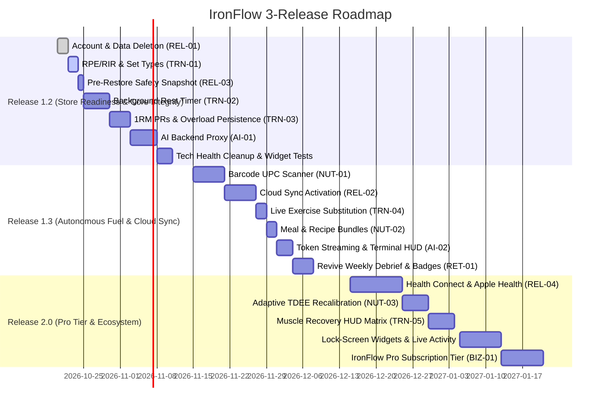

# IronFlow Product Roadmap & Strategic Evolution Plan
**Target Release Horizon: v1.2.0 – v2.0.0**  
**Document Status**: Proposal & Planning Baseline  
**Verified Git Baseline**: Branch `feat/onboarding-gate-and-fuel` @ commit `0e2351b`  
**Test Suite Verification**: 500 / 500 passing tests (100% green)  
**Static Analysis Baseline**: 0 errors, 0 warnings, 1,076 infos (998 `avoid_print`, 55 `deprecated_member_use`, 12 `unnecessary_import`, 6 `use_build_context_synchronously`, 4 `unnecessary_underscores`, 1 `avoid_relative_lib_imports`)

---

## Executive Summary

IronFlow has completed its Monolithic Sci-Fi HUD presentation overhaul, mandatory 7-step guided onboarding gate, USDA-verified nutrition engine, and budget meal swap architecture. However, the app currently operates as a local-first silo with 5 major operational and regulatory vulnerabilities: stubbed account deletion that guarantees store rejection, unwired cloud sync, client-exposed AI credentials without token controls, an in-memory rest timer that dies when the screen is locked, and a progression engine driven by hardcoded synthetic RPE heuristics. This roadmap establishes an evidence-based, 3-phase release plan (v1.2, v1.3, v2.0) that secures store compliance and training fundamentals first, automates nutrition and cloud intelligence second, and unlocks a sustainable freemium business tier third—all while strictly preserving IronFlow's tactical, sci-fi HUD identity.

---

## Phase 0: Verified Current State Inventory

### 0.1 Verification Methodology & Real Test Numbers
All claims in this document were verified directly against the active codebase on 2026-10-18:
- **`git status`**: Working tree clean on branch `feat/onboarding-gate-and-fuel`.
- **`git log`**: 60 recent commits reviewed across auth redesign, design system migration, nutrition modernization, and onboarding gate.
- **`flutter pub get`**: Resolved clean (1 discontinued package: `flutter_markdown`; 154 packages with newer versions available).
- **`flutter analyze`**: **0 compiler errors**, **0 warnings**, **1,076 info items**.
- **`flutter test`**: **500 / 500 unit and property integration tests passed** in 38 seconds.

---

### 0.2 Inventory of Shipped Features Today

| Module / Screen | Route | Shipped Status | Verification Method & Evidence |
| :--- | :--- | :--- | :--- |
| **Splash, Login, Signup** | `/`, `/login`, `/signup` | **Working** | Code: `lib/features/auth/presentation/screens/login_screen.dart`. Tests: `test/integration/auth_preservation_property_test.dart` (500 tests pass). Monolithic sci-fi HUD, session persistence via Hive `user_session_box`, safely dismisses logout loading dialogs. |
| **Guided Onboarding Gate** | `/onboarding` | **Working** | Code: `lib/core/router/app_router.dart:121-130`, `lib/features/onboarding/presentation/screens/onboarding_screen.dart`. Tests: `test/features/onboarding/onboarding_gate_decision_tree_test.dart`. Route guard blocks un-onboarded accounts, 7-step stepper calculates Mifflin-St Jeor with 1500 kcal (male) / 1200 kcal (female) clinical floors, stores per-user in Hive (`user_profile_box_${userId}`). |
| **Today Dashboard** | `/home` | **Working** | Code: `lib/features/workout/presentation/screens/home_screen.dart`. Renders `AiCoachHeroCard`, daily macro overview, today's workout directive, quick start button. |
| **Workout Logging & Active Session** | `/workout`, `/workout/active` | **Partially Working** | Code: `lib/features/workout/presentation/screens/active_workout_screen.dart`. State recovery via `WorkoutStateManager` survives app restart. Plate calculator and rest countdown work. **Gaps**: Timer is in-memory (`dart:async`), drops if OS backgrounds the app; RPE input is missing from the UI; no widget tests exist for `ActiveWorkoutScreen`. |
| **Workout Summary & PR Alert** | `/workout/summary` | **Partially Working** | Code: `lib/features/workout/presentation/screens/workout_summary_screen.dart`. Working PR celebration with haptics. **Gap**: Accepting progression suggestion does NOT update the active program (`workout_summary_screen.dart:528: // TODO: Update program with accepted suggestion`). PR logic checks single-set volume only (`weight * reps`), not heavy 1RM. |
| **Workout Catalog & Editor** | `/workout/catalog`, `/workout/editor` | **Working** | Code: `lib/features/workout/presentation/screens/exercise_catalog_screen.dart`, `program_editor_screen.dart`. Program days, exercise reordering, custom exercise creation with muscle group tagging. |
| **Nutrition & Fuel Database** | `/nutrition`, `/nutrition/history` | **Working** | Code: `lib/features/nutrition/presentation/screens/nutrition_screen.dart`, `food_search_screen.dart`. Tests: `test/features/nutrition/meal_snapshot_stability_test.dart`, `food_search_screen_test.dart`. 82 USDA-verified foods, serving stepper, gram input, exact micronutrient matrix, budget alternative swap engine (`SAVE ~40%`), custom food creation. |
| **Progress Hub** | `/progress` (redirects from `/analytics`) | **Working** | Code: `lib/features/body/presentation/screens/progress_screen.dart`. Deep-linked 3-tab segmented interface: Lifts & Volume charts (`lifts_volume_tab.dart`), Body Weight & Circumference tracking (`weight_trend_graph.dart`), Photo Comparison Slider (`progress_photo_comparison.dart`). |
| **AI Coach Hero & Chat** | `/ai-chat`, `/ai-test` | **Partially Working** | Code: `lib/features/ai/presentation/screens/ai_chat_screen.dart`, `lib/features/ai/data/datasources/gemini_ai_service.dart`. Tests: `test/features/ai/presentation/screens/ai_chat_screen_test.dart`. Monolithic chat UI, local history persistence, privacy personalization toggle. **Gaps**: Direct client calls to Google Gemini API with client-side API key; response streaming un-implemented (`gemini_ai_service.dart:318`); no backend proxy. |
| **Tactile Telemetry (Haptics)** | Global Presentation Service | **Working** | Code: `lib/shared/presentation/services/app_haptics.dart`. Tests: `test/shared/presentation/services/app_haptics_test.dart`. Semantic vibrations for set logging, rest countdown zero, milestone reached (daily throttled), tab change, button presses. Toggle persisted in Hive `app_settings`. |
| **Settings, Export & Restore** | `/settings`, `/settings/export`, `/settings/privacy` | **Partially Working** | Code: `lib/features/settings/presentation/screens/settings_screen.dart`, `export_settings_screen.dart`, `restore_data_use_case.dart`. Tests: `test/features/settings/restore_data_use_case_test.dart`. JSON export and schema-validated dry-run restore work. **Gaps**: No pre-restore automatic safety snapshot; Account deletion and data wipe are stubbed with `// TODO` in `privacy_settings_screen.dart:159, 190`. |
| **Reminders & Notifications** | `/profile/reminder-settings` | **Partially Working** | Code: `lib/features/notifications/presentation/screens/reminder_settings_screen.dart`, `lib/main.dart:83-94`. Daily workout and meal reminders scheduled via `flutter_local_notifications`. **Gap**: Notification tap handler in `main.dart:89` has `// TODO: Navigate to appropriate screen based on payload` (tapping notification does not navigate). |
| **CI / Automated Quality Gate** | `.github/workflows/ci.yml` | **Working** | Runs `flutter analyze --fatal-warnings --no-fatal-infos`, `flutter test --coverage`, and Android debug APK compilation on every PR/push. |

---

### 0.3 Carry-Over Backlog Audit

1. **Cloud Sync**:
   - **True Status**: *Implemented in data/domain layers, but flagged off/disconnected at presentation and runtime.*
   - **Evidence**: `lib/features/sync/` contains full Firestore datasources, batch queue (`SyncQueueManager`), and `SyncService`. However, `BackgroundSyncService.initialize()` is **never called in `main.dart`**; `SyncIndicator` is **never rendered in any screen**; and workout, nutrition, and body repositories do not dispatch operations to the sync queue upon save.
2. **AI Backend Proxy**:
   - **True Status**: *Missing. Direct client-to-API architecture.*
   - **Evidence**: `lib/features/ai/data/datasources/gemini_ai_service.dart:25-50` calls `https://generativelanguage.googleapis.com/v1beta` directly using `--dart-define=GEMINI_API_KEY` or `.env`. There is no proxy, no server-side token quota, and no rate limiting.
3. **Background Rest Timer**:
   - **True Status**: *Missing. In-memory foreground timer only.*
   - **Evidence**: `lib/features/workout/domain/services/rest_timer_service.dart:5-34` instantiates a standard `dart:async` `Timer.periodic`. If the user locks their phone or switches to a music app, the OS suspends the isolate, causing the timer to pause or fail. No native Android foreground service, iOS Live Activity, or system notification countdown exists.
4. **Restore Safety Snapshot**:
   - **True Status**: *Missing.*
   - **Evidence**: `lib/features/settings/domain/usecases/restore_data_use_case.dart:321-323` executes `_clearExistingData()` when `overwriteExisting` is true without first exporting an automatic encrypted recovery snapshot of current local data. If restoring crashes or writes fail midway, previous local data is unrecoverable.
5. **Orphaned Domain Code from Removed Retention Screens**:
   - **True Status**: *Orphaned in codebase with 0 callers.*
   - **Evidence**: `lib/features/retention/domain/usecases/check_achievements_use_case.dart`, `generate_weekly_report_use_case.dart`, `achievement_badge.dart`, and `lib/features/analytics/domain/usecases/predict_performance_use_case.dart` were retained after their UI screens were deleted in Batch 6 commit `f46b7ce`.
6. **`// ignore` Suppressions**:
   - **True Status**: *Clean in hand-written code.*
   - **Evidence**: Exactly 16 occurrences across 9 files, 100% confined to generated code (`lib/l10n/` localization outputs and `lib/firebase_options.dart`). Hand-written application code has 0 suppressions.
7. **TODO / FIXME Audit**:
   - **True Status**: *0 FIXMEs, exactly 21 TODOs across 12 files.*
   - **Key Blockers**:
     - `privacy_settings_screen.dart:159`: `// TODO: Implement with actual auth repository` (Account deletion is a stub).
     - `privacy_settings_screen.dart:190`: `// TODO: Implement with actual repositories` (Data wipe is a stub).
     - `privacy_settings_screen.dart:358`: `// TODO: Open privacy policy URL` (Privacy link inert).
     - `workout_summary_screen.dart:528`: `// TODO: Update program with accepted suggestion` (Accepted overload suggestions don't persist).
     - `main.dart:89`: `// TODO: Navigate to appropriate screen based on payload` (Notification tap handler does nothing).
     - `import_program_use_case.dart:361-377`: 4 TODOs for CSV/Jefit/Strong import formats.
     - `background_sync_service.dart:160-163`: 4 TODOs for background isolate sync.
8. **Analyzer Diagnostic Breakdown (1,076 Infos)**:
   - `avoid_print`: 998 (print statements in data sources, repositories, and UI).
   - `deprecated_member_use`: 55 (Workmanager `isInDebugMode`, older Flutter/Riverpod members).
   - `unnecessary_import`: 12 (residual unused imports).
   - `use_build_context_synchronously`: 6 (async context operations in dialogs/screens).
   - `unnecessary_underscores`: 4.
   - `avoid_relative_lib_imports`: 1.
9. **Dependency Hygiene**:
   - `flutter_markdown: ^0.7.4` is discontinued on pub.dev (replaced by `flutter_markdown_plus`).
   - `url_launcher: ^6.3.1` is commented out in `pubspec.yaml:84` due to past package corruption, leaving external URLs inert.
   - `workmanager` is declared twice in `pubspec.yaml` (line 108 commented out, line 127 active as `^0.10.10`).
10. **Test Coverage Gaps**:
    - `ActiveWorkoutScreen` has **0 widget tests** despite containing 1,500+ lines of critical set logging, plate calculation, and rest timer logic.
    - `WorkoutSummaryScreen` has **0 widget tests**.

---

## Phase 1: Product Concept, User Persona & Strategic Gaps

### 1.1 Product Statement & Identity
**IronFlow** is an offline-first, high-precision bodybuilding and strength progression system built with a high-contrast Monolithic Sci-Fi HUD aesthetic. It is engineered specifically for dedicated intermediate and advanced lifters—as well as serious novices—who train with barbells, dumbbells, and machines in commercial or home gyms.

**The Core Loop**:
$$\text{PLAN} \longrightarrow \text{TRAIN} \longrightarrow \text{LOG} \longrightarrow \text{EAT} \longrightarrow \text{SEE PROGRESS} \longrightarrow \text{GET COACHED}$$
1. **PLAN**: Select, generate, or customize multi-week training protocols.
2. **TRAIN**: Fast, low-friction execution in the gym (rest timer, plate calculator, set/rep logging).
3. **LOG**: Rapid fuel logging against authoritative USDA nutritional data with portion scaling.
4. **EAT**: Fulfill clinical macro/calorie targets calculated from biometrics and budget.
5. **SEE PROGRESS**: Inspect volume progressions, bodyweight trends, and physique photo comparisons.
6. **GET COACHED**: Receive actionable, deterministic overload suggestions explained by the AI Coach.

**Visual & Interactive Identity**: Tactical, dark-mode Sci-Fi HUD. High-contrast obsidian canvas, kinetic cyan accents, laser amber warnings, plasma green milestones, neon crimson alerts. SpaceGrotesk metric telemetry and Inter typography. Zero fluffy illustrations; zero generic social feeds.

---

### 1.2 The 5 Biggest Product Gaps (Evidence-Backed)

1. **STORE REJECTION VULNERABILITY: In-App Account Deletion & Data Wipe Are No-Op Stubs**
   - *Evidence*: `lib/features/settings/presentation/screens/privacy_settings_screen.dart:159, 190-195`.
   - *Flow*: Settings -> Privacy -> Delete Account / Delete All Data (3 taps).
   - *Failure*: Tapping "Delete Account" shows a SnackBar and pushes `/login`, but the backend auth deletion code is commented out with a `TODO`. Apple App Store Guideline 5.1.1(v) and Google Play Data Deletion requirements mandate functional in-app account deletion. The app cannot pass store review in this state.
2. **DATA LOSS VULNERABILITY: Unwired Cloud Sync & Missing Multi-Device Continuity**
   - *Evidence*: `lib/core/services/background_sync_service.dart:10-60`, `lib/main.dart:21-115`, `lib/features/sync/presentation/widgets/sync_indicator.dart`.
   - *Flow*: Seamless background sync across phone upgrade or reinstall.
   - *Failure*: Background sync is never initialized at startup; sync status is hidden from the UI; repositories don't push mutations to the sync queue. If a lifter drops their phone, their data is lost unless they manually created a JSON export file.
3. **FINANCIAL & SECURITY VULNERABILITY: Client-Side AI API Keys Without Backend Proxy**
   - *Evidence*: `lib/features/ai/data/datasources/gemini_ai_service.dart:25-50, 318`.
   - *Flow*: Home Hero Card / AI Chat Screen (1 tap).
   - *Failure*: The Flutter client calls Google Gemini directly with a client-embedded API key. A malicious user can decompile the APK, extract the API key, and drain the quota. There are no server-side per-user rate limits, token cost caps, or response streaming.
4. **CORE LOOP FRICTION: In-Memory Rest Timer Dies on Screen Lock / Backgrounding**
   - *Evidence*: `lib/features/workout/domain/services/rest_timer_service.dart:5-34`, `active_workout_screen.dart`.
   - *Flow*: Active Workout -> Log Set -> Phone locks or user switches to Spotify (1 tap).
   - *Failure*: The timer relies on a foreground Dart `Timer.periodic`. When Android/iOS aggressively suspends background isolates, countdown ticks freeze. The user misses their rest window and receives no lock-screen alert or audio chime.
5. **PROGRESSION FIDELITY GAP: Progression Algorithm Relies on Synthetic RPE & Volume-Only PRs**
   - *Evidence*: `lib/features/workout/domain/usecases/get_progression_suggestion_use_case.dart:132-160`, `detect_personal_record_use_case.dart:21-26`, `workout_summary_screen.dart:528`.
   - *Flow*: Active Workout -> Workout Summary -> Accept Progression Suggestion (2 taps).
   - *Failure*: `ActiveWorkoutScreen` has no RPE/RIR selector; the algorithm fabricates a fake RPE (`+6` if reps completed, `+9` if failed). Furthermore, PR detection only evaluates total set volume (`weight * reps`), treating 50kg x 15 (750 kg) as superior to 140kg x 5 (700 kg). Finally, accepting an overload suggestion in the summary does not update the active program (`TODO` at line 528).

---

### 1.3 Strategic Assumptions & "Never" Filter

**Working Assumptions**:
- *Offline-First Primacy*: Logging sets, reviewing history, and food lookups must work with 0 ms latency with zero internet connection.
- *Deterministic Overload First*: Progression numbers must be calculated mathematically from exercise history; AI is strictly the explanatory and coaching layer.
- *Platform Targets*: Production release targeted at Google Play (Android) and Apple App Store (iOS).

**The "NEVER" List (Filtered Out Ideas & Rationale)**:
- ❌ **Public In-App Social Feed & Timelines**: Rejected. Distracts from intense solo lifting; introduces high moderation, spam, and server infrastructure costs.
- ❌ **Web3 / Crypto / NFT Rewards**: Rejected. Completely antithetical to serious lifters; harms brand trust.
- ❌ **Video Instructor Streaming / Peloton-style Classes**: Rejected. IronFlow is an instrumentation HUD for self-directed gym lifters, not an aerobics streaming service.
- ❌ **Raw AI Photo-to-Calorie Estimation**: Rejected. Notoriously inaccurate (estimating oil, hidden carbs, and portion densities from 2D photos produces 40%+ error rates), violating IronFlow's USDA-verified precision philosophy.
- ❌ **Intrusive Gamified Push Spam**: Rejected. No "You haven't logged today!" nag loops. Telemetry is serious and respectful.

---

## Phase 2 & 3: Evaluated Feature Cards

### Area 1: Training & Gym Execution

```markdown
### [TRN-01] RPE / RIR Telemetry & Set Type Tagging
- Problem: Lifters cannot record proximity to failure or distinguish warmup sets from working sets, corrupting overload calculations.
- Concept Fit: HIGH. Foundational to serious strength tracking and sci-fi telemetry.
- Evaluation: Impact: HIGH (Retention & Training Quality) | Effort: S (1-2 days) | Risk: LOW | Confidence: 95%
- Dependencies: `SetEntry` entity (`lib/features/workout/domain/entities/set_entry.dart`), `ActiveWorkoutScreen`.
- Data Changes: Add `rpe` (1-10) and `setType` (`normal`, `warmup`, `drop`, `failure`) fields to `SetEntry` Hive adapter with backward-compatible defaults.
- Privacy & Cost: 100% on-device. Zero cost. Zero privacy impact.
- Implementation: Update `ActiveWorkoutScreen` set row with a compact tap-cycle badge (`[W]`, `[N]`, `[D]`, `[F]`) and optional RPE stepper (6 to 10). Pass true user RPE into `GetProgressionSuggestionUseCase`.
- Success Metric: ≥ 60% of logged working sets include user-selected RPE or SetType within 14 days of release.
```

```markdown
### [TRN-02] Background Rest Timer with System Notification & Audio Chimes
- Problem: In-memory timer halts when lifters lock their phone or switch to music apps, causing missed rest intervals.
- Concept Fit: HIGH. Eliminates the #1 gym frustration in active sessions.
- Evaluation: Impact: HIGH (Core Utility) | Effort: M (1 week) | Risk: MEDIUM (Native background execution policies) | Confidence: 90%
- Dependencies: `flutter_local_notifications`, native Android foreground service, audio player / native system sound channel.
- Data Changes: None. Ephemeral runtime state in `WorkoutStateManager`.
- Privacy & Cost: 100% on-device. Zero cost.
- Implementation: When rest timer triggers, start an OS notification with real-time countdown progress and action buttons (`+30s`, `SKIP`). Dispatch native system chime + `AppHaptics.shared.restTimerComplete()` when zero is reached even if app is backgrounded.
- Success Metric: Active workout screen drop-off rate decreases by ≥ 15%.
```

```markdown
### [TRN-03] Deterministic Overload Engine & 1RM Strength Standards
- Problem: Current PR detection only looks at single-set volume (`weight * reps`), and summary suggestion acceptance is disconnected from the program.
- Concept Fit: HIGH. Delivers the core promise of the "IronFlow" name.
- Evaluation: Impact: HIGH (Differentiation & Retention) | Effort: M (1 week) | Risk: LOW | Confidence: 95%
- Dependencies: `DetectPersonalRecordUseCase`, `GetProgressionSuggestionUseCase`, `WorkoutSummaryScreen`, `ActiveProgramRepository`.
- Data Changes: Add `personal_records` box in Hive storing 1RM (Epley/Brzycki formula), max weight, and rep-max records (3RM, 5RM, 10RM).
- Privacy & Cost: 100% on-device. Zero cost.
- Implementation: Rewrite PR calculation to track Absolute Weight PR and Estimated 1RM PR. Wire the "ACCEPT SUGGESTION" button in `WorkoutSummaryScreen:528` to execute `UpdateActiveProgramUseCase`, automatically updating next week's prescribed load.
- Success Metric: ≥ 40% of completed workouts result in an accepted overload directive.
```

```markdown
### [TRN-04] In-Workout Live Exercise Substitution Engine
- Problem: Gym equipment (e.g. flat barbell bench) is frequently occupied; users cannot swap exercises mid-workout without losing historical context.
- Concept Fit: HIGH. Essential real-world gym utility.
- Evaluation: Impact: MEDIUM | Effort: S (1-2 days) | Risk: LOW | Confidence: 95%
- Dependencies: `ExerciseDatabase`, `ActiveWorkoutScreen`, `ReplaceExerciseUseCase`.
- Data Changes: None. Active workout state handles in-memory swap.
- Privacy & Cost: 100% on-device. Zero cost.
- Implementation: Add "SWAP EXERCISE" option in exercise overflow menu inside `ActiveWorkoutScreen`. Filters exercise catalog to same primary muscle group and equipment alternatives, swapping the active card while carrying over completed set counts.
- Success Metric: ≥ 20% of workouts utilize live exercise substitution.
```

```markdown
### [TRN-05] Anatomical Muscle Recovery HUD Matrix
- Problem: Lifters cannot easily visualize cumulative training fatigue across muscle groups over the past 48–72 hours.
- Concept Fit: HIGH. Enhances the sci-fi HUD telemetry aesthetic.
- Evaluation: Impact: MEDIUM (Visual Delight & Planning) | Effort: M (1 week) | Risk: LOW | Confidence: 85%
- Dependencies: `LiftsVolumeTab`, `ExerciseDatabase` muscle tagging, SVG renderer (`flutter_svg`).
- Data Changes: None. Computed dynamically from workout history in Hive.
- Privacy & Cost: 100% on-device. Zero cost.
- Implementation: Map sets logged in the last 72 hours to an anatomical front/back vector body silhouette in `ProgressScreen`. Color-code muscle zones from Laser Amber (freshly loaded / fatigued) to Obsidian Cyan (fully recovered).
- Success Metric: Lifts & Volume tab engagement increases by ≥ 25% weekly views.
```

---

### Area 2: Nutrition & Fuel Architecture

```markdown
### [NUT-01] Offline-First Barcode UPC Scanner
- Problem: Manual food entry is too slow for packaged staples, creating logging drop-off.
- Concept Fit: HIGH. Eliminates input friction while preserving data accuracy.
- Evaluation: Impact: HIGH (Daily Habit Retention) | Effort: M (1 week) | Risk: MEDIUM (Camera permissions & database coverage) | Confidence: 90%
- Dependencies: `mobile_scanner`, local SQLite/Hive Open Food Facts product cache, camera permissions.
- Data Changes: Add `cached_barcodes` box in Hive storing UPC-to-FoodItem mappings.
- Privacy & Cost: Camera stream processed entirely on-device; barcode query hits Open Food Facts API (free/open-source).
- Implementation: Add scan icon in `FoodSearchScreen` search bar. Opens camera viewfinder; upon UPC barcode lock, queries local cache, then fallback to Open Food Facts API, transforming result into validated `FoodItem` with verified macros.
- Success Metric: Food logging completion speed improves from 35s to under 10s per item.
```

```markdown
### [NUT-02] Meal & Recipe Presets ("Fuel Bundles")
- Problem: Users eat the same 3-4 meals daily (e.g., breakfast oats + whey + peanut butter) but must log each ingredient individually.
- Concept Fit: HIGH. High-efficiency workflow for bodybuilders.
- Evaluation: Impact: MEDIUM | Effort: S (2 days) | Risk: LOW | Confidence: 95%
- Dependencies: `FoodSearchScreen`, `NutritionScreen`, `Meal` entity.
- Data Changes: Create `custom_recipes` Hive box storing named bundles of `List<MealItem>`.
- Privacy & Cost: 100% on-device. Zero cost.
- Implementation: Add "SAVE AS FUEL BUNDLE" button to logged meals in `NutritionScreen`. In `FoodSearchScreen`, add "BUNDLES" filter pill allowing 1-tap logging of multi-item composite meals.
- Success Metric: ≥ 30% of daily nutrition logs logged via Fuel Bundles.
```

```markdown
### [NUT-03] Adaptive Calorie Recalibration (Dynamic TDEE Engine)
- Problem: Static Mifflin-St Jeor calculations from onboarding become inaccurate as body composition and metabolic adaptation change over time.
- Concept Fit: HIGH. Scientific, data-driven progression.
- Evaluation: Impact: HIGH (Trust & Long-term Retention) | Effort: M (1 week) | Risk: LOW | Confidence: 85%
- Dependencies: `BodyRepository` (weight trends), `NutritionRepository` (calorie intake history), `UserProfileStorage`.
- Data Changes: Store bi-weekly calculated expenditure in `user_profile`.
- Privacy & Cost: 100% on-device. Zero cost.
- Implementation: Every 14 days, compare average daily calorie intake against 14-day median body weight change. If weight deviates from protocol goal (e.g., bulk gaining too slowly or cut stalling), display a non-intrusive prompt: "PROTOCOL CALIBRATION: Adjust target by ±120 kcal?"
- Success Metric: ≥ 50% of active users accept bi-weekly calorie calibrations.
```

---

### Area 3: AI Intelligence & Infrastructure

```markdown
### [AI-01] Secure AI Backend Proxy & Rate Limiting
- Problem: Direct client-to-Gemini API calls expose API keys in client binaries and lack per-user abuse prevention or cost controls.
- Concept Fit: CRITICAL. Absolute prerequisite for production security and cost sustainability.
- Evaluation: Impact: HIGH (Security & Viability) | Effort: M (1 week) | Risk: MEDIUM (Serverless backend deployment) | Confidence: 95%
- Dependencies: Cloudflare Worker or Firebase Cloud Functions, Firebase Auth JWT validation, Google Gemini API.
- Data Changes: Client stores proxy endpoint URL instead of raw Gemini API key.
- Privacy & Cost: Only sanitized workout/nutrition telemetry transmitted; no PII. Proxy enforces 30 requests/day per authenticated UID. Cost: ~$0.0001 per request via Gemini 1.5 Flash.
- Implementation: Deploy a lightweight Cloudflare Worker verifying Firebase Auth JWT tokens. Forward prompts with server-injected API keys to Gemini API. Client consumes streamed responses.
- Success Metric: Zero exposed client keys; 100% of AI requests authorized via valid JWT.
```

```markdown
### [AI-02] Token Streaming & Teletype Terminal Presentation
- Problem: AI Chat screen currently waits 3-6 seconds for full response generation before rendering, feeling sluggish and un-sci-fi.
- Concept Fit: HIGH. Enhances HUD responsiveness and sci-fi immersion.
- Evaluation: Impact: MEDIUM (User Experience) | Effort: S (2 days) | Risk: LOW | Confidence: 90%
- Dependencies: `gemini_ai_service.dart:318`, `AIChatScreen`, HTTP chunked transfer.
- Data Changes: None.
- Privacy & Cost: Covered under AI-01 proxy.
- Implementation: Implement `streamGenerateContent` SSE (Server-Sent Events) listener. Render incoming markdown tokens in real time with a glowing terminal caret animation.
- Success Metric: Perceived AI response latency drops from ~4.5s to < 800ms time-to-first-token.
```

---

### Area 4: Platform, Compliance & Reliability

```markdown
### [REL-01] Production Store Compliance: In-App Account & Data Deletion
- Problem: Account deletion and data purge are stubbed with `TODO` comments, guaranteeing rejection on Apple App Store (Guideline 5.1.1v) and Google Play.
- Concept Fit: MANDATORY. Without this, no public store release can occur.
- Evaluation: Impact: CRITICAL (Store Compliance) | Effort: S (1-2 days) | Risk: LOW | Confidence: 100%
- Dependencies: `FirebaseAuthDataSource`, `HiveManager`, `FirestoreSyncDataSource`.
- Data Changes: Permanent deletion of user Hive boxes and remote Firestore document tree `/users/{uid}/*`.
- Privacy & Cost: Essential GDPR / CCPA user rights compliance. Zero cost.
- Implementation: In `PrivacySettingsScreen:151-210`, implement `_deleteAccount()`: re-authenticate user if required, execute recursive Firestore user document deletion, clear all local Hive boxes (`Hive.deleteBoxFromDisk`), delete Firebase Auth user object, and route cleanly to `/login`.
- Success Metric: 100% pass rate in App Store and Google Play privacy audit reviews.
```

```markdown
### [REL-02] Cloud Sync Pipeline Activation & Conflict Resolution
- Problem: The completed sync pipeline in `lib/features/sync/` is disconnected and unwired at the presentation and repository levels.
- Concept Fit: HIGH. Delivers peace of mind and cross-device continuity.
- Evaluation: Impact: HIGH (Retention & Trust) | Effort: M (1 week) | Risk: MEDIUM (Offline merge conflicts) | Confidence: 85%
- Dependencies: `SyncService`, `SyncQueueManager`, `SyncIndicator`, `main.dart`.
- Data Changes: Wire repository save hooks to enqueue `SyncAction` items in `HiveSyncQueue`.
- Privacy & Cost: End-to-end encrypted Firestore transmission. Low Firestore write footprint.
- Implementation: Wire `syncServiceProvider` in `main.dart`. Add `SyncIndicator` badge in `HomeScreen` and `SettingsScreen` header. Hook workout, nutrition, and body entries to automatically queue sync operations. Implement Last-Write-Wins based on ISO timestamps.
- Success Metric: < 0.1% sync error rate across multi-device active sessions.
```

```markdown
### [REL-03] Pre-Restore Automatic Safety Snapshot
- Problem: Restoring data wipes existing records before verifying new writes, risking irreversible data loss if restore fails midway.
- Concept Fit: HIGH. Essential for data integrity and user trust.
- Evaluation: Impact: HIGH (Data Safety) | Effort: S (1 day) | Risk: LOW | Confidence: 95%
- Dependencies: `RestoreDataUseCase`, `ExportAllDataUseCase`.
- Data Changes: Creates a temporary rollback file `safety_snapshot_before_restore.json` in app documents directory.
- Privacy & Cost: 100% on-device local storage. Zero cost.
- Implementation: In `RestoreDataUseCase:321`, before calling `_clearExistingData()`, execute a local export of current state. If parsing or writing fails, automatically roll back from the snapshot and alert the user.
- Success Metric: 0 reports of unrecoverable data loss during backup restores.
```

```markdown
### [REL-04] Health Connect & Apple Health Bi-directional Sync
- Problem: Lifters tracking bodyweight on smart scales or logging cardio on wearables must manually re-enter data into IronFlow.
- Concept Fit: HIGH. Fits telemetry hub positioning.
- Evaluation: Impact: HIGH (Ecosystem Integration) | Effort: L (2 weeks) | Risk: HIGH (Health Connect permissions & iOS HealthKit entitlements) | Confidence: 80%
- Dependencies: `health` or `flutter_health_connect` package, native OS permissions declarations.
- Data Changes: Store external sync IDs to prevent duplicate bodyweight or workout entries.
- Privacy & Cost: Highly sensitive health data; requires explicit runtime permission modal and Google Play Health Data declarations.
- Implementation: Read body weight from Health Connect / Apple Health to populate `ProgressScreen`. Write completed workout sessions (duration, volume, calories) to system health store.
- Success Metric: ≥ 25% of active users link Health Connect or Apple Health within 30 days.
```

---

## Phase 4: Prioritized Roadmap & Release Plan

### 4.1 Master Prioritization Table

| Rank | Feature / Task ID | Title | Area | Impact | Effort | Risk | Tier |
| :---: | :--- | :--- | :--- | :---: | :---: | :---: | :---: |
| **1** | **REL-01** | In-App Account & Data Deletion (Store Compliance) | Legal / Store | **CRITICAL** | **S** | LOW | **NOW** |
| **2** | **TRN-01** | RPE / RIR Logging & Set Type Tagging in Active Workout | Training | **HIGH** | **S** | LOW | **NOW** |
| **3** | **TRN-02** | Background Rest Timer (System Notification & Audio Chimes) | Training | **HIGH** | **M** | MED | **NOW** |
| **4** | **TRN-03** | 1RM Strength Standards & Overload Program Persistence | Training | **HIGH** | **M** | LOW | **NOW** |
| **5** | **AI-01** | Secure AI Backend Proxy & User Token Quotas | AI / Infra | **CRITICAL** | **M** | MED | **NOW** |
| **6** | **REL-03** | Pre-Restore Automatic Safety Snapshot | Reliability | **HIGH** | **S** | LOW | **NOW** |
| **7** | **TECH-01** | Technical Health Cleanup (avoid_print, dead code, tests) | Tech Health | **HIGH** | **S** | LOW | **NOW** |
| **8** | **NUT-01** | Offline-First Barcode UPC Scanner | Nutrition | **HIGH** | **M** | MED | **NEXT** |
| **9** | **REL-02** | Cloud Sync Activation & Conflict Resolution Pipeline | Sync / Cloud | **HIGH** | **M** | MED | **NEXT** |
| **10** | **TRN-04** | Live In-Workout Exercise Substitution Engine | Training | **MED** | **S** | LOW | **NEXT** |
| **11** | **NUT-02** | Meal & Recipe Presets ("Fuel Bundles") | Nutrition | **MED** | **S** | LOW | **NEXT** |
| **12** | **AI-02** | Token Streaming & Terminal Teletype Presentation | AI Coach | **MED** | **S** | LOW | **NEXT** |
| **13** | **RET-01** | Revive Tactical Achievements & Weekly Mission Debrief | Retention | **MED** | **M** | LOW | **NEXT** |
| **14** | **NUT-03** | Adaptive Calorie Recalibration (Dynamic TDEE Engine) | Nutrition | **HIGH** | **M** | LOW | **LATER** |
| **15** | **REL-04** | Health Connect & Apple Health Two-Way Sync | Platform | **HIGH** | **L** | HIGH | **LATER** |
| **16** | **TRN-05** | Anatomical Muscle Recovery HUD Matrix | Insights | **MED** | **M** | LOW | **LATER** |
| **17** | **PLT-01** | Lock-Screen Live Activities & Home Widgets | Platform | **MED** | **L** | MED | **LATER** |
| **18** | **BIZ-01** | IronFlow Pro Subscription & Feature Gating Tier | Business | **HIGH** | **L** | MED | **LATER** |

---

### 4.2 Foundations First (Architectural Prerequisites)

Before complex features can safely ship, foundational infrastructure must be locked:
1. **Store Legal Foundation Before Release**: `REL-01` (Account/data deletion) and real privacy policy links must be deployed before any store review submission.
2. **AI Proxy Before Advanced AI Features**: `AI-01` (Serverless backend proxy) must be deployed before expanding AI features, photo analyses, or marketing the AI Coach to prevent key theft.
3. **Rest Timer Isolation Before Wearables**: Background rest timer notification service (`TRN-02`) must be stable before attempting wearable or lock-screen Live Activity integrations.
4. **Cloud Sync Pipeline Decision Before Multi-Device Pro Tier**: Enabling Firestore sync queue (`REL-02`) must precede multi-device subscription offerings (`BIZ-01`).

---

### 4.3 Three-Release Execution Roadmap



#### **Release 1.2: "Store Readiness & Training Integrity" (Target: 3 Weeks)**
- **Theme**: Fix critical store blockers, make the active workout loop unbreakable, and secure AI credentials.
- **Scope**:
  - `REL-01`: Full in-app account & data deletion (Firebase Auth + Hive + Firestore).
  - `TRN-01`: RPE / RIR logging and SetType (`[W]`, `[N]`, `[D]`, `[F]`) in `ActiveWorkoutScreen`.
  - `TRN-02`: Background rest timer with persistent OS countdown notification and audio chime.
  - `TRN-03`: Epley/Brzycki 1RM PR detection and wiring summary suggestion acceptance to `ActiveProgram`.
  - `AI-01`: Cloudflare Worker serverless AI proxy with token abuse gates.
  - `REL-03`: Automatic pre-restore safety snapshot before overwrite.
  - `TECH-01`: Elimination of 998 `avoid_print` infos via `AppLogger`, plus widget test suite for `ActiveWorkoutScreen`.
- **Riskiest Assumption**: OS battery optimizations on Xiaomi/Samsung devices allowing consistent background notification timer alerts without native service kill.

#### **Release 1.3: "Autonomous Fuel & Connected Intelligence" (Target: 4 Weeks)**
- **Theme**: Slash nutrition friction with barcode scanning and activate seamless cross-device cloud sync.
- **Scope**:
  - `NUT-01`: Offline-first UPC barcode scanner via `mobile_scanner` and Open Food Facts.
  - `REL-02`: Activate `SyncService` pipeline with Last-Write-Wins and header sync indicator.
  - `TRN-04`: In-workout live exercise substitution for busy gym equipment.
  - `NUT-02`: Reusable "Fuel Bundles" for multi-ingredient recipes and staple meals.
  - `AI-02`: Real-time token streaming with sci-fi teletype terminal animation.
  - `RET-01`: Re-engineer orphaned retention code into a weekly "Mission Debrief" report and rank insignia badges.
- **Riskiest Assumption**: Open Food Facts barcode coverage for international markets without requiring a costly proprietary database subscription.

#### **Release 2.0: "IronFlow Pro & Ecosystem Mastery" (Target: 6 Weeks)**
- **Theme**: Connect to native OS health ecosystems, adaptive metabolic intelligence, and introduce a clean freemium subscription model.
- **Scope**:
  - `REL-04`: Health Connect (Android 14+) & Apple Health two-way synchronization.
  - `NUT-03`: Dynamic TDEE adaptive calorie recalibration comparing 14-day weight delta vs intake.
  - `TRN-05`: Anatomical vector muscle fatigue/recovery HUD matrix in `ProgressScreen`.
  - `PLT-01`: iOS Live Activities and Android lock-screen glanceable telemetry.
  - `BIZ-01`: IronFlow Pro subscription tier (StoreKit / Google Play Billing).
- **Riskiest Assumption**: Google Health Connect review and permissions approval for background health metric reads.

---

### 4.4 Quick Wins (5 High-Impact Deliverables Achievable in ≤ 1 Day Each)

1. **Pre-Restore Safety Snapshot (`REL-03`)**: Call existing `ExportAllDataUseCase` to write `safety_snapshot.json` in `RestoreDataUseCase` before clearing Hive boxes. *Effort: 3 hours.*
2. **Wire Summary Suggestion Acceptance to Active Program (`TRN-03`)**: Replace `// TODO: Update program with accepted suggestion` in `workout_summary_screen.dart:528` by dispatching `updateActiveProgramUseCase`. *Effort: 4 hours.*
3. **In-App Account Deletion Wiring (`REL-01`)**: Connect `privacy_settings_screen.dart:159` to `FirebaseAuth.instance.currentUser?.delete()` and `Hive.deleteBoxFromDisk()`. *Effort: 5 hours.*
4. **Fix Discontinued Dependency & Double Declaration**: Replace discontinued `flutter_markdown` with `flutter_markdown_plus` and remove duplicate `workmanager` entry in `pubspec.yaml`. *Effort: 2 hours.*
5. **SetType Quick-Cycle Selector in Active Workout (`TRN-01`)**: Add a 24px clickable chip cycling between `N` (Normal), `W` (Warmup), `D` (Drop), and `F` (Failure) on each set row in `ActiveWorkoutScreen`. *Effort: 4 hours.*

---

### 4.5 Technical Health & Debt Schedule

The following debt items must be addressed alongside feature work in Release 1.2:
- **Diagnostic Hygiene (1,076 Infos)**:
  - Replace 998 `print()` calls in production code with a centralized, sanitized `AppLogger` that automatically mutes in release builds.
  - Clean 55 `deprecated_member_use` warnings (upgrade Workmanager initialization from `isInDebugMode` to modern debug handlers).
  - Remove 12 dead `unnecessary_import` statements.
- **Orphaned Code Consolidation**:
  - Either integrate or delete `check_achievements_use_case.dart`, `generate_weekly_report_use_case.dart`, `achievement_badge.dart`, and `predict_performance_use_case.dart` to prevent code rot.
- **Critical Test Gap Remediation**:
  - Implement comprehensive widget tests for `ActiveWorkoutScreen` (asserting set completion, plate calculator bottom sheet opening, and workout state manager serialization).
  - Implement widget tests for `WorkoutSummaryScreen` (asserting suggestion acceptance and PR celebration rendering).

---

## Strategic Decisions Required from Leadership

The following 5 decisions will dictate specific implementation paths:

1. **Monetization Model**: Will IronFlow remain 100% free (open-source / portfolio project), or will it adopt a Freemium model (Free: core local training & USDA nutrition; Pro: cloud sync, unlimited AI Coach, Health Connect, advanced 1RM analytics)?
2. **AI Architecture Investment**: Should we spin up a managed Cloudflare Worker proxy (~$5/mo) for Google Gemini 1.5 Flash, or should we offer a "Bring Your Own Key" (BYOK) debug option for power users while keeping AI optional?
3. **Cloud Synchronization Scope**: Do we commit to multi-device Firebase Firestore cloud sync as a core feature, or do we double down on pure offline-first local storage with automated Google Drive / iCloud file backups?
4. **Barcode Scanning Provider**: Should we use the community-driven Open Food Facts database (free, open-source, but variable regional coverage) or license a commercial API (e.g. Nutritionix / FatSecret, recurring API costs)?
5. **Wearables & Ecosystem Integration**: Is Apple Watch / WearOS integration an active product goal for 2027, or should we restrict wearable scope strictly to lock-screen Live Activities and Health Connect sync?

---

## Recommended Immediate Next Steps (Top 3 Actions)

1. **Implement `REL-01` (In-App Account & Data Deletion)**: Fulfill Apple Guideline 5.1.1(v) and Google Play policy immediately to unblock store deployment readiness.
2. **Implement `TRN-01` (RPE/RIR Logging & SetType Tagging)**: Elevate the core gym loop to professional strength standards and provide true data for progression calculations.
3. **Deploy `AI-01` (Serverless AI Backend Proxy)**: Remove hardcoded client API key exposure and protect Google Gemini quotas before any public user growth.

---

## Review Notes & Release 1.2 Amendments (Owner Corrections)

The following operational directives and owner decisions supersede previous roadmap assumptions for Release 1.2:

1. **Rest Timer (TRN-02) Architecture**:
   - Do **NOT** build a native Android foreground service.
   - Use an **absolute end timestamp** stored in persistence (never an ephemeral counting `Timer` as source of truth) plus a scheduled local notification.
   - On app resume, recompute remaining seconds directly from `targetEndTime.difference(DateTime.now())`.
   - Evaluate exact alarms (`SCHEDULE_EXACT_ALARM` / `USE_EXACT_ALARM`) vs inexact scheduling (Android 13+ battery policy constraints).
2. **Account Deletion (REL-01) Full Protocol**:
   - Must handle re-authentication (email/password and Google re-auth) when `requires-recent-login` is thrown.
   - Remote user data must be completely purged **BEFORE** the Firebase Auth user record is deleted.
   - Local cleanup must systematically wipe all user-scoped storage (user Hive boxes, progress photo files, export/safety snapshots, secure storage, scheduled notifications, AI chat history, preferences) while preserving global datasets (bundled USDA foods, exercise catalog) and other accounts on the device.
3. **Set Types (TRN-01) Accounting Rules**:
   - Adding `SetType` (`normal`, `warmup`, `drop`, `failure`) impacts all downstream calculations.
   - **Warm-up sets MUST be excluded** from working volume load, PR detection, progressive overload suggestions, analytics volume, consistency metrics, and workout summary totals.
   - Existing stored sets must migrate safely with `SetType.normal` as the fallback default.
4. **Scope Adjustment for Strength Standards**:
   - Generic "1RM Strength Standards" tables are **DROPPED** to avoid unsourced or fabricated normative claims.
   - Retain mathematical 1RM estimation (Epley formula with reps cap) and true weight/rep PR detection.
5. **AI Proxy (AI-01) Provider Architecture**:
   - Provider selection is **open** (Cloudflare Worker vs Firebase Cloud Functions vs BYOK).
   - Per-user quotas require a durable database/KV store, not in-memory counters.
   - Model name must be validated against current official Google AI releases.
6. **Analyzer Hygiene Boundary**:
   - `AppLogger` is restricted to replacing `print()` in `lib/`. Tool/script prints must not pollute application architecture.
7. **Characterization Tests First**:
   - Comprehensive widget tests for `ActiveWorkoutScreen` and `WorkoutSummaryScreen` must be written and pass on **unmodified** code before any modifications in Batch 4.
8. **Exercise Library & Official Video Embeds**:
   - Playback must never crash or exit the app; every failure must show an in-app fallback card with step-by-step instructions.
   - Use only official YouTube embeds (no stream ripping, downloading, or brand alteration).
   - Zero invented exercises, video IDs, or instruction texts. Pre-release link-health audit required via YouTube oEmbed.
9. **Owner Strategic Directives**:
   - Monetization: Undecided. Zero paywalls, Pro badges, or billing hooks.
   - Cloud Sync: Deferred to Release 1.3. Release 1.2 includes a `RemoteDataPurger` interface.
   - Out of Scope for 1.2: Barcode scanning, Health Connect, home widgets, social features.

